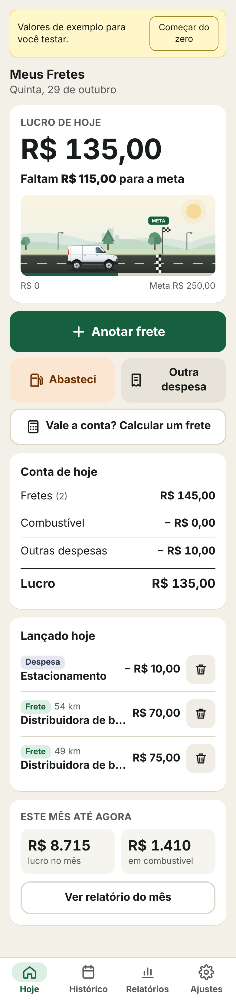
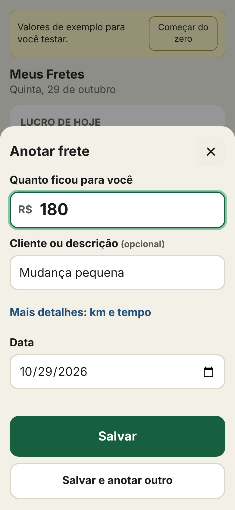
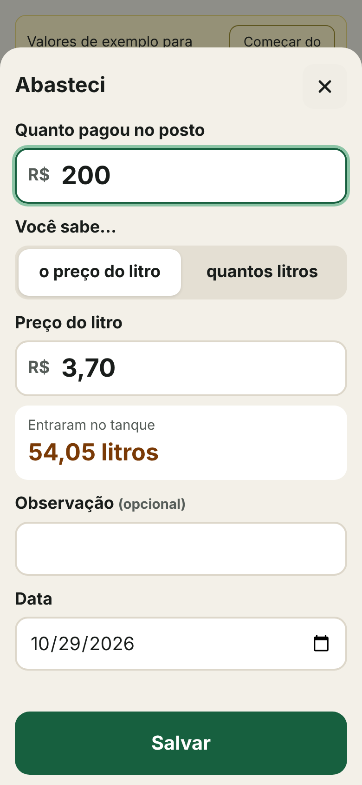
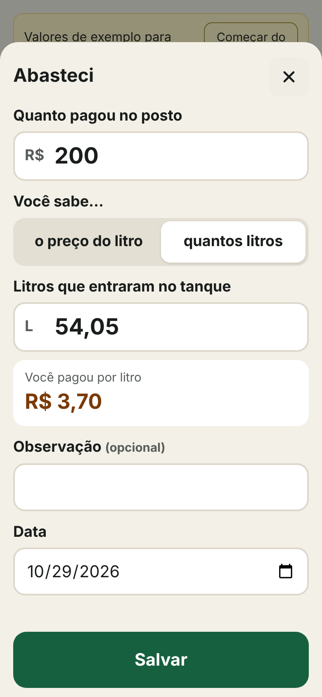
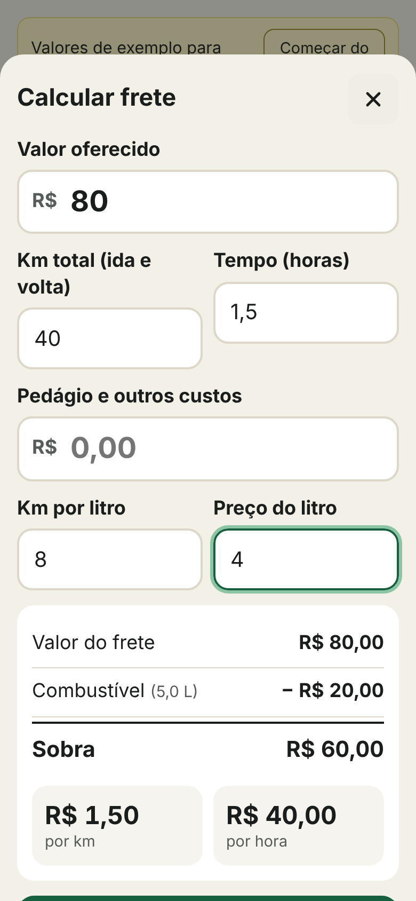
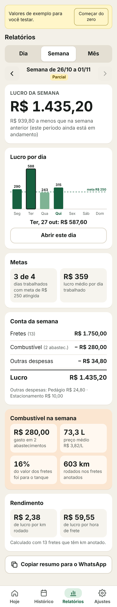
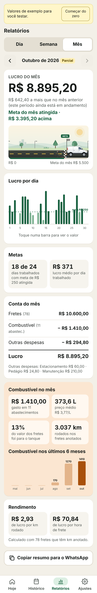
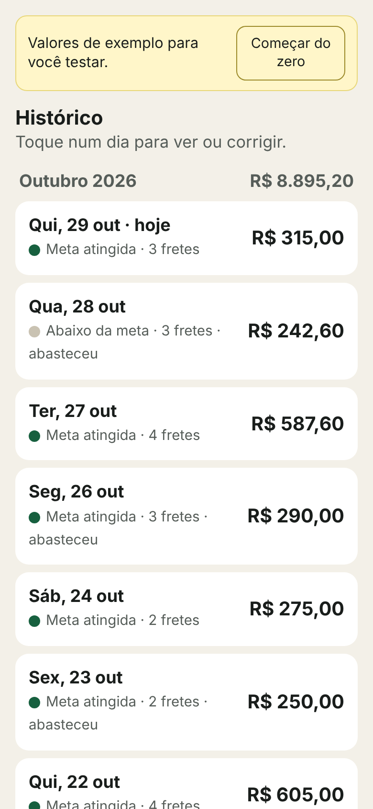
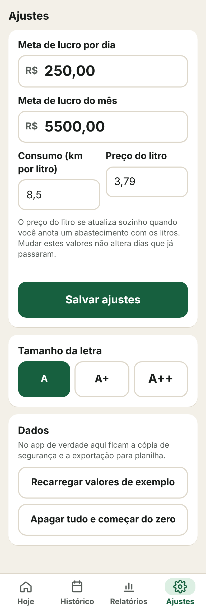
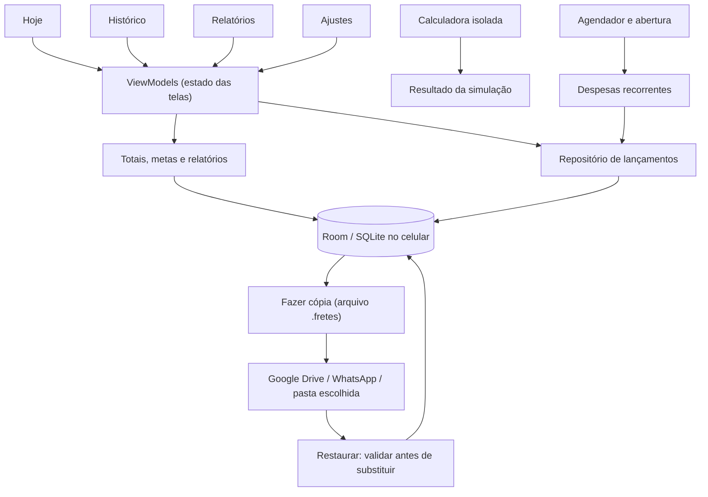

# Meus Fretes: arquitetura e design

Repositório: [Fomes1574/FretesHumberto](https://github.com/Fomes1574/FretesHumberto) · Android, uso familiar · consolidado em 30 de outubro de 2026

> **Situação (30/10/2026):** o app Android tem banco, telas, contas do mês e cópia de segurança, testados na JVM pelo GitHub Actions, que gera o APK debug. **Ainda não foi aberto num celular nem assinado.** As imagens abaixo vêm do **protótipo web navegável** (`docs/prototipo.html`) usado para validar o design com o motorista. Os valores mostrados são fictícios. O protótipo foi atualizado com as regras desta revisão; as imagens em `docs/img/` são referências visuais da versão original e não documentam todos os novos fluxos.

---

A leitura detalhada das regras está em [REGRAS_DE_NEGOCIO.md](REGRAS_DE_NEGOCIO.md), com decisões em [DECISOES.md](DECISOES.md). O protótipo é evidência do comportamento implementado; o modelo Android abaixo continua sendo proposta.

## 1. Objetivo

O app é para um motorista de Fiorino, que faz fretes todos os dias e tem pouca familiaridade com tecnologia. Ele precisa:

- anotar fretes, abastecimentos e despesas em poucos toques;
- ver **quanto lucrou hoje**, depois de descontar o combustível e as outras despesas;
- acompanhar uma **meta diária** (a meta mensal foi retirada em 30/10/2026);
- consultar relatórios de **dia, semana, mês e período personalizado de até 6 meses**, com destaque para o **gasto de combustível**;
- mandar um resumo para o filho pelo WhatsApp.

A versão Android deverá funcionar no próprio celular, sem cadastro, servidor, publicidade nem mensalidade. A implementação atual é o protótipo de navegador descrito em [ESTADO_ATUAL.md](ESTADO_ATUAL.md).

---

## 2. Decisões tomadas

| Tema | Decisão |
|---|---|
| Navegação | Quatro abas com ícone e texto: **Hoje**, **Histórico**, **Relatórios** e **Ajustes** |
| Registro rápido | Na tela Hoje: **Anotar frete** (botão principal), **Abasteci**, **Outra despesa** e **Calcular um frete** |
| Independência | Fretes e despesas são lançamentos independentes, cadastrados um a um por dia. Excluir ou mover um frete nunca exclui nem move despesas |
| Calculadora | Verificação isolada de uma viagem; seus valores e custos não criam, alteram ou excluem lançamentos do controle diário |
| Contas mensais | Despesas recorrentes já na primeira versão, com o mesmo tratamento das demais despesas; sem módulo de investimentos |
| Campos obrigatórios | Frete: valor, com data começando em hoje. Km, tempo e descrição opcionais. Abastecimento: valor + preço ou litros. Recorrência: nome, valor e repetição |
| Abastecimento | Valor pago + **preço do litro _ou_ quantos litros**. O app calcula o que faltar |
| Casas decimais | No máximo **2 casas depois da vírgula**. Aceitar decimal com ponto ou vírgula e valores brasileiros colados com separador de milhar, sem alterar seu significado |
| Combustível no lucro | Pelos **abastecimentos informados**: o valor pago sai do lucro do dia em que ele abasteceu |
| Meta | Só diária; vale do dia em que mudou em diante. Textos usados: "Faltam R$ X", "Meta atingida" ou "Meta atingida · R$ X acima" |
| Animação da meta | Fiorino numa estrada animada que anda até a linha de chegada. Ao bater a meta, ela cruza a linha e sai confete (seção 5) |
| Relatórios | Dia, semana, mês e período personalizado de até 6 meses; seleção de dois dias para somar e comparar; gráfico de lucro por dia e bloco de combustível |
| Semana | Segunda-feira às 00:00 até domingo às 23:59, incluindo todo o último minuto, no horário local do celular |
| Edição | Qualquer viagem do histórico pode ser editada a qualquer momento, sem prazo e sem bloqueio por fechamento de dia, semana ou mês |
| Linguagem | Simples e direta. Nada de "compensa / não compensa" nem semáforo de lucratividade: o app mostra números, quem decide é o motorista |
| Dados | Ficam **no celular**. A cópia de segurança é exportada para onde ele escolher. Não usa servidor nem Cloudflare (seção 8) |
| Plataforma | Android nativo: Kotlin + Jetpack Compose + Room |

---

## 3. Telas

### 3.1 Hoje



De cima para baixo:

1. **Lucro de hoje**, o número maior da tela. O protótipo corrigido mostra imediatamente o resultado final; a estrada mantém sua animação.
2. Situação da meta em texto ("Faltam R$ 115,00 para a meta").
3. A **estrada da meta** com a Fiorino.
4. Botões de lançamento.
5. **Conta de hoje**: fretes − combustível − outras despesas = lucro.
6. **Lançado hoje**: toque no item para corrigir, lixeira para apagar (com **Desfazer** por 6 segundos).
7. Resumo do mês até agora (lucro e combustível) e atalho para o relatório do mês.

Fretes e despesas são registrados separadamente, um por vez. A ordem de cadastro não muda a conta: ele pode lançar todos os fretes e depois todas as despesas. **Apagar um frete apaga somente aquele frete.** Despesas manuais, abastecimentos e despesas recorrentes permanecem nos seus respectivos dias. O mesmo vale ao mudar a data do frete.

**Contas do mês** abre pelo Histórico ou pelos Ajustes, sem criar uma quinta aba. O cadastro mensal pede descrição, valor, dia e repetição; a ocorrência gerada é uma despesa comum e independente.

### 3.2 Anotar frete



- Campo "Quanto ficou para você": é o valor líquido, já sem taxa de plataforma, para a mesma taxa não ser descontada duas vezes.
- Cliente ou descrição é opcional.
- **Mais detalhes** pode registrar km rodados e duração opcional em minutos, para referência. A verificação de custo por viagem e os resultados R$/km e R$/hora ficam apenas na calculadora separada.
- A data não pode ficar no futuro.
- **Salvar e anotar outro**, para lançar em sequência os fretes do fim do dia.
- Proteção contra toque duplo no Salvar.
- Qualquer viagem do histórico pode ser corrigida quando o usuário quiser, inclusive depois de meses ou anos. Valor, data, descrição, km e duração continuam editáveis. Ao mudar a data, atualizar o dia de origem e o de destino, seus totais e suas metas, usando a meta vigente em cada data. Nenhuma despesa é movida ou modificada junto. O limite de consulta de 6 meses não limita a idade do lançamento nem o direito de editá-lo.

### 3.3 Abasteci

| Sabe o preço do litro | Sabe quantos litros |
|---|---|
|  |  |

- O motorista digita **quanto pagou** e escolhe o que ele sabe:
  - **o preço do litro** → o app calcula os litros (R$ 200,00 ÷ R$ 3,70 = **54,05 L**);
  - **quantos litros** → o app calcula o preço do litro (R$ 200,00 ÷ 54,05 L = **R$ 3,70/L**).
- O preço do litro já vem preenchido com o abastecimento de data financeira mais recente. Na maioria das vezes ele só digita o valor pago. Registrar um abastecimento antigo não substitui indevidamente a referência atual.
- Ao trocar de opção, o número já calculado é levado junto.
- O preço do abastecimento mais recente passa a ser a referência da calculadora. Editar ou excluir esse abastecimento reavalia qual é a referência mais recente; um preço definido manualmente nos Ajustes pode ser usado como alternativa explícita.

### 3.4 Calcular um frete



- Entradas: valor que fica para o motorista, km totais (incluindo coleta e retorno quando houver), duração opcional em minutos, pedágio e outros custos informados para essa verificação.
- Consumo (km/l) e preço do litro já vêm preenchidos e podem ser editados.
- Saída: combustível estimado, **sobra**, R$/km e R$/hora. Sem tempo informado, o R$/hora não aparece.
- Essa tela é uma **simulação independente**. Ele informa o valor e as despesas de uma viagem somente para verificar sua sobra, sem ligação com os fretes e despesas cadastrados no dia.
- Retirar o botão **Fiz este frete, salvar**. As ações da calculadora são calcular, limpar e fechar; nenhuma delas lança frete, abastecimento ou despesa no diário.
- Alterar o preço ou o consumo dentro da simulação vale só para aquele cálculo. A referência global só muda pelos Ajustes ou pelo abastecimento mais recente.
- Fechar ou limpar a calculadora não modifica o lucro, as metas ou os relatórios. Se quiser registrar a viagem realizada, o motorista volta a Anotar frete e registra os gastos separadamente nas suas datas.

### 3.5 Relatórios

| Semana | Mês |
|---|---|
|  |  |

- Seletor **Dia / Semana / Mês / Período**. As setas voltam para períodos anteriores. A semana começa **segunda-feira às 00:00** e termina **domingo às 23:59**, incluindo todo o último minuto, no horário local do celular. Como as datas financeiras não têm hora, a implementação filtra da segunda-feira inclusive até a segunda-feira seguinte exclusive; assim nenhum segundo do domingo fica de fora.
- **Período personalizado:** datas inicial e final incluídas, com intervalo máximo de 6 meses de calendário. Para a implementação, o fim exclusivo não pode ultrapassar o início mais 6 meses; por exemplo, 1º de janeiro a 30 de junho. Pode consultar intervalos antigos: os registros não são apagados após 6 meses.
- **Dois dias escolhidos:** mostrar os valores separados e a soma dos dois, sem incluir automaticamente os dias intermediários.
- Período em andamento recebe o selo **Parcial**.
- **Lucro do período** com comparação neutra: "R$ X a mais / a menos que na semana anterior".
- Quando a semana ou o mês está em andamento, a comparação padrão usa o mesmo recorte do período anterior: segunda a quinta contra segunda a quinta, por exemplo. Para mês, limitar a comparação ao mesmo dia disponível no mês anterior. Comparação de períodos completos deve ser identificada como tal.
- **Gráfico de lucro por dia**:
  - linha tracejada mostrando a meta diária;
  - barra verde-escura quando a meta foi atingida, verde-clara quando não, vermelha quando o dia deu negativo;
  - tocar numa barra mostra o valor do dia e o botão **Abrir este dia**.
- **Metas**: "18 de 24 dias trabalhados com meta atingida" e lucro médio por dia trabalhado.
- **Conta do período**, com as outras despesas por categoria.
- **Combustível no período**: total gasto, nº de abastecimentos, litros, preço médio por litro, % do valor dos fretes que foi para o tanque e km rodados.
- No mês: gráfico **Combustível nos últimos 6 meses** (sem meta mensal).
- **Rendimento por km/hora:** fica somente na calculadora de viagem. Como os fretes e despesas do diário são independentes, os relatórios não atribuem custos a fretes específicos nem dividem o lucro total pelos km ou minutos de uma amostra incompleta.
- **Dia**: conta do dia, lista de lançamentos editável e botão para anotar naquele dia.
- **Copiar resumo para o WhatsApp**: texto pronto com fretes, combustível, despesas, lucro e metas.

### 3.6 Histórico



- Dias agrupados por mês, com o lucro de cada mês no cabeçalho.
- Cada dia mostra: lucro, nº de fretes, se abasteceu, e um ponto verde quando a meta foi atingida. O texto acompanha, porque a cor nunca é a única informação.
- Tocar no dia abre o relatório daquele dia para conferir ou corrigir.
- A edição de qualquer viagem antiga continua disponível sem limite de tempo. Terminar uma semana ou mês não bloqueia alterações. Uma correção recalcula todos os períodos afetados, preservando a meta válida em cada data.
- Não há marca de "dia conferido" (retirada em 30/10/2026).

### 3.7 Ajustes



- Meta diária, consumo (km/l) e preço do litro.
- Tamanho da letra: **A / A+ / A++**, além de respeitar o tamanho de fonte do Android.
- Na versão Android, esta tela também concentra: fazer cópia, restaurar cópia, exportar para planilha e bloqueio por biometria (opcional).
- Mostrar a data da última cópia e um lembrete semanal dentro do aplicativo. A senha da cópia é opcional. Essa é uma função local do app, não uma automação do ChatGPT.

---

## 4. Linguagem visual

| Elemento | Escolha |
|---|---|
| Fonte | **Atkinson Hyperlegible**, criada para máxima legibilidade. Corpo do texto em ~18 sp; valores principais em ~46 sp |
| Fundo | Bege claro `#F3F0E8`, com cartões brancos |
| Texto | Quase preto `#191D1B`, com contraste alto |
| Lucro / meta | Verde `#17603F` (claro `#DCEFE3`) |
| Combustível | Laranja queimado `#A8500B` (claro `#FBE6D1`) |
| Negativo | Vermelho `#A9221B`, sempre com sinal de menos (−) |
| Botões | Pelo menos 48 dp; ações principais com 60–68 dp; cantos arredondados de 14–18 dp |
| Ícones | Sempre acompanhados de texto nas ações |
| Ícone do app | Fiorino branca em movimento sobre estrada, sol e céu verde; versão monocromática para ícones temáticos. Arquivos `res/drawable/ic_launcher_*.xml`; prévia em `img/13-icone.png` |

---

## 5. Estrada da meta (animação)

| A caminho | Em movimento | Meta atingida |
|---|---|---|
|  |  |  |

### Cena

- **Céu e sol.**
- **Paisagem em três camadas com profundidade:**
  - morros e prédios ao fundo, que andam a 18% da velocidade da estrada;
  - árvores e postes, que andam a 55%;
  - faixas amarelas da estrada, que andam a 100%.
- **A Fiorino**, furgão branco de perfil, desenhada em vetor: vidros, lanterna, farol, pisca, retrovisor, linhas das portas, para-choques e rodas de liga leve.
- **Faixa verde** na borda da estrada, mostrando o caminho já percorrido.
- **Linha de chegada**: faixa quadriculada, bandeira e placa **META**.

### Regras de movimento

| Situação | O que acontece |
|---|---|
| Abrir o app | A van sai do início e anda até a posição do lucro atual |
| Lançar um frete abaixo da meta | A van **arranca, acelera e freia** até a nova posição. A estrada corre mais rápido que a van e as rodas giram na mesma velocidade |
| Bater a meta | A van **atravessa a linha de chegada** e estaciona do outro lado. Ao cruzar, sai **confete** da bandeira, que cai e fica no asfalto por ~5 s |
| Lançar valores **acima da meta** | O número mostra o **valor final na hora**. A van e a estrada ficam paradas |
| Apagar ou corrigir e ficar **abaixo da meta** | A van **dá ré**, atravessa a linha de volta e para na posição certa. A estrada e as rodas andam ao contrário e não há confete |
| Trocar de aba e voltar | Nenhuma animação se nada mudou |
| "Reduzir movimento" ligado no Android | A van vai direto à posição final, sem animação nem confete |

### Detalhes técnicos que evitam glitches

- **Posição:** a van é posicionada pela **frente**. O início fica em x = 100. A frente encosta na linha em x = 249 quando o lucro chega a 100% da meta. Na posição "meta atingida" (x = 357), a traseira já passou da linha.
- **Movimento:** curva *ease-in-out* (cúbica). A duração é de 1,1 s + 7 ms por unidade percorrida. O protótipo corrigido mantém o valor final visível imediatamente; não é necessário esperar a animação para conferir o saldo.
- **Rodas:** acima de ~6° por quadro, os raios somem num borrão circular. Isso evita o efeito estroboscópico, em que a roda parece girar para trás.
- **Primeiro quadro:** a estrada e as rodas são posicionadas antes do primeiro quadro de cada animação, para não haver salto quando a tela é redesenhada.
- **Confete:** fica preso à linha de chegada, que é fixa, e não acompanha a rolagem da estrada.
- **Sem inclinação de suspensão e sem fumaça:** foram testadas e causavam desalinhamento e manchas visuais.
- **No app Android:** a cena vira um `Canvas` do Compose, com `Animatable` para a posição e `rememberInfiniteTransition` desligado em repouso. A mesma regra de posição vale para os dois.

---

## 6. Regras das contas

### Lucro

```
Lucro do dia = fretes do dia − abastecimentos do dia − demais despesas cadastradas no dia
```

- É um resultado gerencial com os custos informados. Não inclui depreciação, impostos ou custos que não foram cadastrados.
- O valor do frete é considerado na data do lançamento. Não haverá controle de pagamento pendente, contas a receber ou status de recebimento.
- O lucro negativo é mostrado como negativo, nunca é cortado em zero.
- Todo valor que o motorista cadastrar como despesa reduz o resultado da data informada, independentemente da descrição. Não haverá separação de investimentos nem um módulo para dinheiro guardado. O aplicativo não executa pagamentos ou aplicações bancárias.
- Fretes, abastecimentos e despesas são independentes. Não existe exclusão, alteração de data ou associação automática em cascata entre um frete e despesas. Cada lançamento é editado ou apagado individualmente.
- Despesas mensais geradas automaticamente usam a mesma regra das despesas manuais. O total diário é recalculado a partir da base de lançamentos, evitando totais próprios divergentes em cada tela.

### Combustível

- **Método padrão: pelos abastecimentos.** O valor pago no posto entra no dia do abastecimento.
- Litros e preço por litro ficam guardados em cada abastecimento:

```
Modo preço:  litros = valor ÷ preço        (arredondado a 2 casas)
Modo litros: preço  = valor ÷ litros       (arredondado ao centavo)
```

- **Combustível do período:** soma dos valores, soma dos litros, e preço médio = valor total ÷ litros totais.
- **% para o tanque** = combustível ÷ valor dos fretes do período.
- A estimativa pelo consumo (km ÷ km/l × preço) é usada **só na calculadora**. Ela nunca é descontada do lucro, para o mesmo combustível não sair duas vezes.

### Calculadora

```
Combustível estimado = km ÷ km/l × preço/l
Sobra                = valor − combustível estimado − outros custos
R$/km                = sobra ÷ km
R$/hora              = sobra ÷ horas      (omitido sem tempo)
```

- Consumo e preço precisam ser maiores que zero. Nenhuma conta divide por zero.
- Os valores da simulação não são gravados como viagens ou despesas e não participam das contas do dia. Não haverá dados de combustível da calculadora vinculados a um frete do diário.
- Alterar Ajustes não modifica fretes, despesas ou abastecimentos antigos. Cada abastecimento preserva o valor, os litros e o preço registrados.

### Médias e metas

- R$/km e R$/hora são resultados exclusivos da simulação de uma viagem. Os relatórios do período mostram os totais efetivamente cadastrados, sem ratear despesas entre fretes.
- **Meta diária atingida** quando o lucro do dia ≥ meta. Contam só os dias trabalhados, ou seja, com pelo menos um frete.
- A nova **meta diária** vale a partir da data escolhida, por padrão hoje, e não substitui a meta válida nos dias anteriores. Relatórios consultam a meta da respectiva data, não a configuração atual.
- Corrigir lançamentos antigos muda os resultados daquele período; isso é diferente de substituir sua meta histórica.

### Números

- Dinheiro sempre guardado em **centavos inteiros**.
- Entrada com no máximo 2 casas decimais. Reconhecer separador de milhar antes de normalizar decimal: `1.234,56` e `R$ 1.234,56` precisam resultar em R$ 1.234,56; `85.50` pode resultar em R$ 85,50. Entradas ambíguas devem ser corrigidas pelo usuário, sem conversão silenciosa para outro valor.
- Duração em minutos inteiros, ou controles separados de horas e minutos. Abrir e salvar uma viagem sem alterar sua duração preserva o valor original: 17 minutos não viram 18 minutos por arredondamento.
- Datas financeiras sem horário (`AAAA-MM-DD`), separadas da data técnica de criação e edição.

---

## 7. Arquitetura técnica

**Android nativo: Kotlin + Jetpack Compose + Material 3.** Banco local Room (SQLite), DataStore para preferências e WorkManager para as despesas recorrentes já na primeira versão. Todos os cálculos e gráficos rodam no aparelho. A calculadora usa um estado próprio, separado dos lançamentos financeiros.



- As telas observam a mesma base (`Flow` do Room). Nenhuma tela guarda totais próprios.
- Gráficos e a estrada animada em **Compose Canvas**, sem biblioteca paga nem serviço externo.

### Modelo de dados (Room, versão 2)

Implementado em `app/.../data/Entidades.kt`; esquema exportado em `app/schemas/`.

| Tabela | Campos principais |
|---|---|
| `lancamento` | `id`, `tipo` (FRETE / ABASTECIMENTO / DESPESA), `data` (AAAA-MM-DD), `valor` (centavos), `descricao`; opcionais por tipo: `kmCentesimos`, `minutos`, `litrosCentesimos`, `precoLitro`, `modoAbastecimento`, `categoria`, `ocorrencia` (única); `criadoEm`, `editadoEm`. Índice por `data` |
| `conta` | `id`, `inicio` |
| `conta_versao` | `contaId` + `desde` (AAAA-MM, chave), `nome`, `valor`, `dia` original, `ativa`, `categoria`, `fim?` |
| `ocorrencia` | `contaId` + `mes` (chave: única por conta e mês), `status` (PREVISTA / GERADA / PULADA), `lancamentoId?`, exceção do mês (`altData`, `altValor`, `altDescricao`, `altCategoria`) |
| `meta_diaria` | `desde` (chave), `valor` |
| `ajuste` | pares chave/valor: consumo e preço manual (data, valor, carimbo) |

Os detalhes de cada tipo ficaram como colunas opcionais da própria tabela `lancamento`, em vez de tabelas separadas: é mais simples e não cria nenhuma coluna que ligue gasto a frete. Tamanho da letra e data da última cópia ficam no DataStore (preferências do aparelho). Gravações em transação, IDs estáveis e migrações versionadas; sem atualização destrutiva.

Não existe relacionamento frete–despesa no banco. A calculadora não grava nessas tabelas. Excluir um frete afeta só esse registro e seus detalhes técnicos opcionais. Despesas e abastecimentos seguem intactos. Um erro de gravação não pode exibir “Salvo”; uma falha de leitura não pode substituir os dados por exemplos.

---

## 8. Onde os dados ficam e segurança

**O GitHub guarda o código. Os números do motorista ficam no celular dele.** Não é necessário Cloudflare, servidor ou banco na nuvem.

| O quê | Onde fica |
|---|---|
| Código do app | Repositório `Fomes1574/FretesHumberto` |
| Fretes, gastos, metas | Banco Room na área privada do app, no celular |
| Cópia de segurança | Arquivo exportado pelo botão **Fazer cópia**, com senha opcional, salvo onde o motorista escolher (Google Drive dele, WhatsApp para o filho, pasta do celular) |
| Backup automático do Android | Política explícita no manifesto e nas regras por versão: desativar backup em nuvem por padrão e definir transferência entre aparelhos. Não depender da ausência de configuração, pois o padrão do Android pode permitir backup |
| Chave de assinatura do APK | **Fora do repositório**: nos *Secrets* do GitHub Actions e numa cópia guardada pelo filho |

### Cuidados com o repositório

- **No repositório público**: nunca colocar nele dados reais, arquivos de cópia, `google-services.json` nem a chave de assinatura.
- `.gitignore` mínimo:

  ```gitignore
  *.jks
  *.keystore
  keystore.properties
  local.properties
  *.fretes
  /backups/
  ```

- **Se a chave de assinatura se perder**, as atualizações deixam de instalar por cima da versão antiga. Guarde duas cópias.
- O app não pede acesso a contatos, localização, SMS ou banco.

### Quando um servidor faria sentido (futuro, opcional)

Somente para ver os mesmos dados em dois celulares ao mesmo tempo, por exemplo o filho acompanhando os fretes do pai. Nesse caso, avaliar Supabase ou Firebase no plano gratuito, com login. Isso acrescenta conta, senha e dependência de internet, por isso fica fora da primeira versão.

---

## 9. Build e entrega (custo zero)

| Parte | Escolha |
|---|---|
| Desenvolvimento | Android Studio (gratuito) |
| Build do APK | Computador próprio ou CI gratuito disponível; verificar limites/permissões da conta antes de configurar. Ainda não há workflow ou APK |
| Assinatura | Mesma chave sempre, guardada fora do repositório |
| Instalação | APK enviado direto para o celular do pai. Não precisa de Play Store |
| Atualização | Novo APK assinado com a mesma chave, instalado por cima e sem perder dados |

---

## 10. Estrutura do repositório

Criada em 30/10/2026. O `:core` tem as regras, a cópia e os textos, com testes; o `:app` tem banco, telas, agendador e cópia.

```
FretesHumberto/
├─ core/                        (Kotlin puro, sem Android — ./gradlew :core:test)
│  └─ src/main/kotlin/.../core/
│     ├─ Dinheiro.kt            (parse, arredondamento, filtro de digitação, Formato)
│     ├─ Datas.kt               (semana seg–dom, mês, período, comparação, 6 meses)
│     ├─ Modelo.kt              (Lancamento, Metas, textoMeta)
│     ├─ Calculos.kt            (Relatorio.resumir, Calculadora, Combustivel)
│     ├─ Recorrencias.kt        (contas do mês, vencimento, geração idempotente)
│     ├─ Diario.kt              (salvar, apagar, desfazer — vira transação Room)
│     └─ Estrada.kt             (posição da van, confete, curva, borrão das rodas)
├─ app/                         (Android: Compose + Material 3)
│  └─ src/main/kotlin/io/github/fomes1574/freteshumberto/
│     ├─ MainActivity.kt
│     ├─ ui/FretesApp.kt        (abas, telas por cima, avisos, restauração)
│     ├─ ui/theme/Tema.kt       (cores, Atkinson Hyperlegible, tipografia)
│     ├─ data/                  (Room, DAO, repositório com transações, DataStore)
│     ├─ ui/hoje/ historico/ relatorios/ ajustes/ lancamento/ contas/ estrada/ comum/
│     ├─ contas/                (WorkManager das contas do mês)
│     └─ backup/                (arquivo .fretes pelo seletor do Android)
├─ docs/                        (regras, decisões, plano, protótipo)
├─ src/ tests/                  (protótipo web e seus 32 testes Node)
├─ .github/workflows/android.yml
└─ CLAUDE.md / AGENTS.md
```

---

## 11. Próximas etapas

| Prioridade | Item |
|---|---|
| v1 | Telas Hoje, Histórico, Relatórios, Ajustes e lançamentos como no protótipo |
| v1 | Período personalizado de até 6 meses, seleção de dois dias e edição de viagens sem prazo limite |
| v1 | Estrada animada em Compose com as regras da seção 5 |
| v1 | Fazer cópia / restaurar com validação |
| v1 | Desfazer exclusão e proteção contra toque duplo |
| v1 | **Contas do mês**: cadastro de despesas recorrentes independentes, sem tratamento de investimentos |
| v1 | Calculadora exclusivamente para simulações, sem gravar frete ou despesa no diário |
| v1 | Meta diária com vigência (sem meta mensal) e comparação de períodos equivalentes |
| v1 | Data da última cópia, senha opcional e lembrete semanal dentro do app |
| v1 | Corrigir interpretação de dinheiro, edição de duração, referência de preço e falhas silenciosas de gravação |
| v2 | Exportar resumo mensal em CSV/PDF |
| v2 | Manutenção e troca de óleo por km |
| v1.1+ | Melhorias inspiradas em outros apps: ver [MELHORIAS_PESQUISADAS.md](MELHORIAS_PESQUISADAS.md) |
| Futuro | Sincronização entre dois celulares (seção 8) |

### Regras já definidas para as contas do mês (v1)

- Dia 29, 30 ou 31 vira dia 28 em fevereiro, seguindo a regra escolhida para este projeto. Nos meses de 30 dias, só o dia 31 é ajustado para 30: dia 29 continua 29 e dia 30 continua 30. O dia original fica guardado para os meses seguintes.
- Cada ocorrência é única pela combinação conta + mês. Reabrir o app, restaurar uma cópia ou rodar o agendador de novo não duplica lançamentos.
- O agendador (WorkManager) roda sem depender de horário exato e é conferido também ao abrir o app.
- Um mês pulado continua pulado. Pausar não apaga o histórico.
- Editar oferece duas opções: **Só este mês** ou **Deste mês em diante**.
- Cada ocorrência gerada é uma despesa independente de qualquer frete. Pausar ou excluir a regra de repetição não apaga automaticamente despesas já lançadas.

---

## 12. Critérios de validação

1. Fretes líquidos de R$ 285,00 − abastecimento R$ 40,00 − despesas R$ 20,00 = **R$ 225,00**. Com meta de R$ 250,00, aparece "Faltam R$ 25,00". A taxa já descontada no valor líquido não é subtraída novamente.
2. Calculadora com R$ 80,00, 40 km, 8 km/l, R$ 4,00/l e 1,5 h → combustível R$ 20,00, sobra R$ 60,00, **R$ 1,50/km** e **R$ 40,00/h**. *(Conferido no protótipo.)*
3. Abasteci com R$ 200,00 e preço R$ 3,70 → **54,05 L**. Com R$ 200,00 e 54,05 L → **R$ 3,70/L**. *(Conferido no protótipo.)*
4. Digitar `54.0599` num campo decimal resulta em `54,05`. *(Conferido no protótipo.)*
5. Lucro acima da meta → o valor final aparece na hora e a posição da van e da estrada não muda. *(Medido no protótipo; regra em `core/Estrada.kt`.)*
6. Apagar um frete e ficar abaixo da meta → a van volta à posição proporcional, sem confete. *(Medido no protótipo.)*
7. Cruzar a meta → a van termina depois da linha e o confete aparece uma única vez.
8. Salvar com toque duplo cria um único lançamento.
9. Mudar preço, consumo ou meta não altera dias anteriores.
10. O mesmo combustível nunca é descontado duas vezes (abastecimento × estimativa).
11. Cópia e restauração reproduzem todos os lançamentos. Uma cópia inválida não substitui o banco.
12. Atualizar o APK assinado com a mesma chave preserva os dados.
13. Em modo avião funcionam registro, cálculos, histórico, relatórios e gráficos.
14. Letra no maior tamanho (A++ e fonte grande do Android) não corta valores nem botões.
15. A semana inclui a segunda-feira desde 00:00 e todo o domingo até o fim de 23:59; a segunda-feira seguinte pertence a outra semana.
16. O período personalizado inclui as duas datas, aceita até 6 meses de calendário e não elimina nem bloqueia lançamentos mais antigos.
17. Editar uma viagem de qualquer data atualiza os períodos afetados. Mudar sua data atualiza tanto o dia original quanto o novo, com as metas vigentes correspondentes.
18. Selecionar dois dias soma somente os dois dias escolhidos e permite compará-los.
19. Excluir ou mudar a data de um frete deixa todos os abastecimentos e despesas intactos nas suas datas originais.
20. Simular, limpar ou fechar a calculadora não cria nem altera nenhum lançamento, lucro, meta ou relatório.
21. Cadastrar despesa mensal gera uma ocorrência por mês, sem duplicação ao reabrir ou restaurar; mês pulado continua pulado.
22. Colar `R$ 1.234,56` mantém o valor R$ 1.234,56. Editar somente a descrição de uma viagem de 17 minutos preserva os 17 minutos.
23. Atualizar a meta diária vale do dia em que mudou em diante e preserva a meta dos dias anteriores.
24. Comparar uma semana parcial usa os mesmos dias da semana anterior. Registrar abastecimento antigo não substitui indevidamente o preço mais recente.

A revisão do protótipo inclui 32 testes automatizados das regras e verificações na interface de lançamentos, edição antiga, filtros, metas, recorrência, calculadora, restauração com senha e letra ampliada. A conta do item 1 e a independência do item 19 também foram conferidas na interface. O relatório [design-qa.md](../design-qa.md) distingue os testes realizados e as limitações. Todos os critérios aplicáveis precisam ser repetidos no app Android; o item 12 depende de APK e não foi testado. O salvamento físico do arquivo de backup e o uso offline precisam de conferência no aparelho final.

### Ajustes de escopo confirmados em 29/10/2026

- Retirado o controle de pagamento pendente e seu campo no modelo de dados.
- Semana fixada de segunda-feira às 00:00 até domingo às 23:59, incluindo todo o último minuto.
- Consulta personalizada limitada a 6 meses por intervalo, com histórico preservado.
- Edição de viagens sem prazo de expiração, recalculando os resultados afetados.
- Retirado o tratamento específico de investimentos: valores cadastrados como despesas seguem a regra comum das despesas.
- Fretes e despesas são independentes; excluir um frete apaga somente o frete. A calculadora fica separada, exclusivamente para verificar uma viagem.
- Contas mensais passam a integrar a primeira versão. Aceitas as regras de meta mensal por mês escolhido, comparação equivalente de períodos e cópia com senha opcional e lembrete semanal.
- Essas regras estão consolidadas neste documento e representadas no protótipo HTML atualizado que acompanha o projeto. O protótipo usa armazenamento local do navegador e gera as despesas vencidas ao abrir ou retomar a página; Room e WorkManager continuam como arquitetura prevista para o aplicativo Android.

---

## 13. Referências

- [Android: Room](https://developer.android.com/training/data-storage/room)
- [Android: WorkManager](https://developer.android.com/develop/background-work/background-tasks/persistent)
- [Android: acessibilidade](https://developer.android.com/guide/topics/ui/accessibility/apps)
- [Android: backup automático e regras de extração](https://developer.android.com/guide/topics/data/autobackup)
- [Android: assinatura e publicação de APK](https://developer.android.com/studio/publish)
- [GitHub Actions: cobrança e uso](https://docs.github.com/en/actions/concepts/billing-and-usage)
- [Atkinson Hyperlegible (Braille Institute)](https://www.brailleinstitute.org/freefont/)
