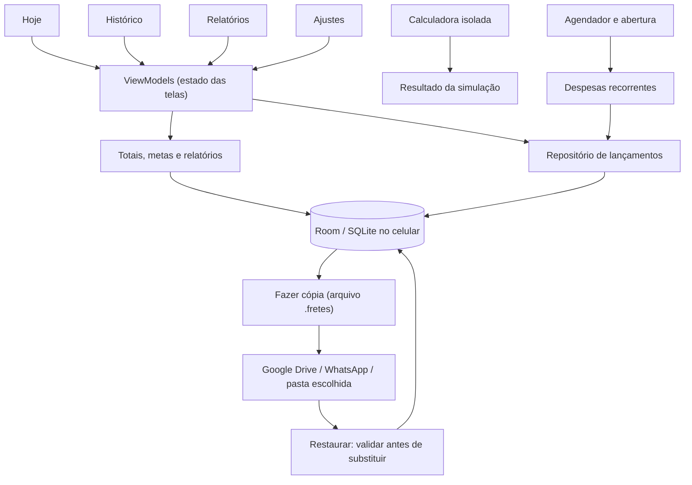

# Meus Fretes — contexto completo para programação

> Consolidação de 30/10/2026. Projeto e protótipo web; Android ainda não implementado.
> Arquivo gerado por `scripts/build_context.py`. Edite os documentos-fonte e regenere; não mantenha uma segunda especificação manual aqui.

Esta cópia reúne objetivo, instruções, regras, decisões, estado, arquitetura, plano, testes e histórico. Instruções atuais do usuário prevalecem. Os links apontam para as fontes mantidas no repositório.


---

Documento-fonte: [README.md](../README.md)


## Meus Fretes — FretesHumberto

Controle simples de fretes, abastecimentos, despesas e metas para um motorista Android com pouca familiaridade com tecnologia. O foco é anotar os valores e ver quanto sobrou no dia, com histórico e relatórios fáceis de consultar.

**Situação em 30/10/2026: projeto e protótipo web. O aplicativo Android ainda não foi implementado. Não há APK.** O código atual usa HTML/JavaScript e armazenamento no navegador. Kotlin, Compose, Room e WorkManager são a arquitetura prevista.

### Documentação

| Necessidade | Documento |
|---|---|
| Um único MD com o contexto inteiro | [CONTEXTO_COMPLETO.md](CONTEXTO_COMPLETO.md) |
| Instruções para IA de programação | [AGENTS.md](../AGENTS.md) |
| Contrato das regras financeiras | [REGRAS_DE_NEGOCIO.md](REGRAS_DE_NEGOCIO.md) |
| Telas, design e arquitetura Android prevista | [ARQUITETURA.md](ARQUITETURA.md) |
| O que existe e o que ainda falta | [ESTADO_ATUAL.md](ESTADO_ATUAL.md) |
| Etapas de desenvolvimento Android | [PLANO_ANDROID.md](PLANO_ANDROID.md) |
| Testes e limites da validação | [TESTES.md](TESTES.md) e [design-qa.md](../design-qa.md) |
| Decisões e alterações | [DECISOES.md](DECISOES.md) e [CHANGELOG.md](../CHANGELOG.md) |

### Regras essenciais

- **Lucro = fretes líquidos − abastecimentos − outras despesas**, nas datas selecionadas.
- Fretes e gastos são independentes. Apagar ou mover um frete não apaga nem move despesas.
- A calculadora só simula; seus valores não entram no diário.
- Sem contas a receber, módulo de investimentos ou julgamento “compensa/não compensa”.
- Semana de segunda a domingo. Intervalos personalizados de até seis meses por consulta, com histórico preservado e editável.
- Contas mensais com ocorrência única por conta+mês. Dia 31 ajusta para 30 quando necessário; fevereiro usa 28 para vencimentos 29–31, inclusive bissexto, conforme decisão do projeto.
- Metas diárias com vigência; meta mensal por mês escolhido. Não sobrescrever metas antigas.
- Sem cadastro, servidor, anúncios, assinatura ou API paga. Dados reais ficam no aparelho.

As regras detalhadas estão em [REGRAS_DE_NEGOCIO.md](REGRAS_DE_NEGOCIO.md). “Lucro” significa o resultado dos valores cadastrados, sem estimar custos ausentes.

### Testar

Baixe o repositório e abra `docs/prototipo.html` no navegador. O arquivo incorpora fonte, desenhos e criptografia, sem carregar serviços externos. A página de arquivo do GitHub mostra o código, não executa o protótipo.

Alternativa com Node 22 ou superior:

```sh
npm run dev
```

Abra o endereço indicado pelo servidor na porta 4173. `docs/mobile.html` apresenta o protótipo em uma área de 390 px; não é um emulador Android.

Os dados iniciais são **fictícios**. “Começar do zero” permite testar sem os exemplos. Os registros ficam no `localStorage` desse navegador e podem desaparecer ao limpar seus dados. Não use o protótipo como único registro financeiro.

### Testes e geração

Node 22+ e Python 3. Não precisa instalar dependências para rodar os testes existentes ou gerar o HTML usando o bundle de criptografia já incluído:

```sh
npm test
npm run build:html
node --check src/prototipo-check.js
```

Para modificar e reconstruir a criptografia:

```sh
npm ci
npm run build:crypto
npm run build:html
npm test
```

Edite `src/` e regenere `docs/prototipo.html`. O gerador aproveita CSS, ícones, estrada e dados fictícios de `src/template-original.html`; a lógica antiga desse template não é a lógica vigente. O mapa das funções está em [ESTADO_ATUAL.md](ESTADO_ATUAL.md).

### Situação dos testes

Os 32 testes automatizados passam. A interface foi revisada no navegador em 29/10/2026, incluindo restauração com senha e letra ampliada. **Nenhum teste Android físico, build de APK ou migração Room foi realizado.** O salvamento físico do arquivo de backup não foi confirmado na automação e precisa de teste completo no aparelho. A recorrência atual funciona ao abrir/retomar a página, sem execução com navegador fechado.

Não há publicação automática, workflow de build, integração com a Lalamove ou serviços de nuvem. Exportação CSV/PDF, biometria, manutenção por km e sincronização ainda não foram implementadas.

### Organização

| Caminho | Conteúdo |
|---|---|
| `docs/prototipo.html` | Protótipo atualizado |
| `src/core.js` | Cálculos, datas, metas, recorrência e validação |
| `src/app.js` | Telas, formulários, armazenamento e cópias |
| `src/build.py` | Geração do HTML final |
| `src/backup-crypto.js` e bundle | Proteção de cópia também sem WebCrypto |
| `tests/` | Testes e fixture fictícia |
| `docs/img/` | Referências visuais originais, anteriores às correções |
| `docs/LICENCAS/` | Licenças dos componentes incorporados |
| `scripts/build_context.py` | Gera o MD de contexto completo |

O objetivo continua sendo custo zero. GitHub Actions para o APK futuro depende dos limites e permissões vigentes da conta; não é uma etapa já configurada nem uma garantia de disponibilidade. O protótipo atual não depende desse serviço.

---

Documento-fonte: [AGENTS.md](../AGENTS.md)


## Instruções para agentes de programação

### Situação e leitura

Projeto em fase de planejamento, com protótipo HTML funcional e arquitetura Android prevista. Não há módulo Android, Gradle wrapper, APK ou banco Room nesta revisão. Não descreva decisões planejadas como funções entregues.

Leia: `README.md`, `docs/REGRAS_DE_NEGOCIO.md`, `docs/ESTADO_ATUAL.md`, `docs/ARQUITETURA.md`, `docs/PLANO_ANDROID.md` e `docs/TESTES.md`. `docs/CONTEXTO_COMPLETO.md` reúne esses documentos automaticamente; não é uma segunda especificação para editar à mão.

Instruções explícitas do usuário prevalecem. Para decisões de produto, use as regras e o registro de decisões; para funcionamento implementado, confira código e testes. Divergência do código é pendência, não autorização para alterar a regra. Imagens antigas e o template original não substituem os requisitos.

### Não regredir

1. Fretes, despesas e abastecimentos são independentes. Nenhuma despesa tem vínculo financeiro com frete. Excluir/mover frete só afeta ele e seus detalhes técnicos.
2. Combustível sai do diário pelos abastecimentos cadastrados. A estimativa fica só na calculadora isolada, que não grava lançamentos.
3. Não reintroduzir recebimento pendente, CDB/investimentos ou classificação de rentabilidade.
4. Datas financeiras locais sem horário. Semana segunda inclusiva até a próxima segunda exclusiva. Sem relatórios por hora; duração opcional em minutos continua permitida.
5. Filtro de seis meses não apaga histórico nem impede editar lançamentos antigos. Conferir dia não bloqueia edição.
6. Preservar metas históricas. Meta mensal pertence ao mês de referência.
7. Recorrência idempotente, única por conta+mês. Respeitar mês pulado, versões e exceções. Fevereiro usa dia 28 para vencimentos 29–31, inclusive bissexto: é decisão deliberada.
8. Não adicionar backend, login, analytics, IA no produto, API paga ou dependência de internet. Linguagem curta, comum e centrada nos valores.
9. Nunca versionar dados financeiros reais, cópias pessoais, chaves ou credenciais. A fixture existente é fictícia e documentada.
10. Sem migração destrutiva, limpeza de banco, troca silenciosa por exemplos ou mensagem “Salvo” depois de falha.

### Onde editar

- `src/core.js`: regras puras; centavos inteiros, IDs estáveis e prejuízo preservado.
- `src/app.js`: UI, persistência e cópias; validar e persistir antes de assumir sucesso.
- `src/template-original.html`: fonte de CSS, ícones, cena e seed extraídos por `src/build.py`. Não restaurar sua lógica antiga na aplicação atual.
- `docs/prototipo.html`: saída gerada. Não corrigir só esse arquivo; regenerar após editar fontes.
- `src/backup-crypto.bundle.js`: bundle gerado; manter fonte e lockfile coerentes ao alterar dependências.
- `src/prototipo-check.js`: temporário para checar sintaxe, não versionar.
- `docs/img/`: referências originais, não capturas dos novos fluxos.

Preservar Atkinson Hyperlegible, bege/verde, quatro abas e estrada/Fiorino. Ajustes de legibilidade são permitidos; nova direção visual depende de pedido do usuário.

### Validação e entrega

Após alterar regras/código: `npm test`. Após alterar fontes do HTML: `npm run build:html` e `node --check src/prototipo-check.js`. Para UI, conferir fluxos afetados em largura de celular com letra normal e A++. Teste Node não comprova acessibilidade, download ou funcionamento nativo Android.

Para documentação, conferir links locais, coerência entre implementado/previsto e executar `python3 scripts/build_context.py`. Não inventar APK, meses de uso real, testes no celular ou confirmação de download.

Antes de programar Android, seguir `docs/PLANO_ANDROID.md`. Portar o comportamento, não a estrutura de localStorage. Regras financeiras fora da UI; transações e migrações Room; mesmos casos de referência em Kotlin. O modelo Android do documento é proposta, não migração pronta.

Na entrega, relatar mudanças, testes realmente executados, limitações e pendências. Modificar documentos/protótipo não equivale a concluir o aplicativo Android.

---

Documento-fonte: [docs/REGRAS_DE_NEGOCIO.md](REGRAS_DE_NEGOCIO.md)


## Regras de negócio — contrato do produto

Consolidação em 30/10/2026 das decisões acordadas. Estes requisitos guiam o protótipo e o futuro Android; não significam que o app nativo exista. Veja também [DECISOES.md](DECISOES.md).

### R01 — Lançamentos independentes

Três tipos: frete, abastecimento e despesa. Cada um tem ID, data financeira e valor próprios, cadastrado um a um. Pode anotar todos os fretes e depois os gastos, ou em outra ordem: a conta não muda.

Frete recebe o valor líquido que ficou para o motorista, sem descontar novamente a taxa já retida pela plataforma. Não haverá status de recebimento ou contas a receber.

Excluir um frete remove só ele e seus detalhes técnicos opcionais. Mudar sua data recalcula origem e destino. Nenhuma ação move, edita ou apaga despesas, abastecimentos ou outros fretes. O banco não terá chave de despesa para frete.

### R02 — Resultado financeiro

```text
lucro = soma dos fretes líquidos − soma dos abastecimentos − soma das outras despesas
```

Somar apenas as datas selecionadas. Despesas mensais entram como despesas comuns quando lançadas. Qualquer saída cadastrada como despesa reduz o resultado, independentemente do nome; sem módulo de investimentos.

Fretes R$ 285 − combustível R$ 40 − despesas R$ 20 = **R$ 225**. Com meta R$ 250, faltam **R$ 25**. Apagando só o frete, permanecem R$ 60 de gastos e o resultado fica **−R$ 60**. Nunca cortar prejuízo em zero.

“Lucro” é o resultado dos custos informados; não estima impostos, depreciação ou gastos ausentes. Um dia só com gastos aparece no histórico e reduz o período.

### R03 — Dinheiro, datas e edição

- Dinheiro em centavos inteiros; no Android não usar ponto flutuante para dinheiro.
- `R$ 1.234,56`, `1.234,56` e `1234,56` preservam R$ 1.234,56; `85.50` pode representar R$ 85,50. Rejeitar ambiguidade sem inventar valor.
- O parser atual considera `1.234` ambíguo: corrigir para `1234,00` ou `1.234,00`. Não transformar silenciosamente em R$ 1,23.
- Entrada limita a duas casas por truncamento: `54.0599` vira `54,05`. Resultados calculados de divisão são arredondados a duas casas; não confundir as operações.
- Valores de lançamentos são positivos; o tipo define entrada ou saída. Resultados podem ser negativos.
- Data financeira local sem horário: `AAAA-MM-DD`. Criação/edição técnica tem timestamp separado.
- Novos lançamentos começam em hoje, sem data financeira futura. Campos adicionais dependem do tipo: abastecimento exige preço ou litros; recorrência exige nome e repetição.
- Edição sem prazo de expiração. Qualquer lançamento antigo pode ser corrigido, mesmo depois de conferido. Duração opcional em minutos inteiros: abrir/salvar 17 minutos mantém 17.

### R04 — Combustível

Abastecimento sai integralmente no dia em que foi cadastrado financeiramente, mesmo se o combustível for usado depois. Não ratear entre fretes ou dias.

```text
litros = valor pago ÷ preço por litro
preço por litro = valor pago ÷ litros
preço médio do período = soma dos valores pagos ÷ soma dos litros
percentual para o tanque = combustível ÷ fretes × 100
```

R$ 200 ÷ R$ 3,70 = **54,05 L**; R$ 200 ÷ 54,05 L = **R$ 3,70/L**, arredondados. Sem litros ou fretes, omitir indicador correspondente em vez de dividir por zero.

Guardar os dados de cada abastecimento. A referência de preço vem do mais recente por **data financeira**, com desempate técnico; lançamento antigo não pode tomar o lugar do mais novo. Editar/excluir o mais novo reavalia a referência. Ajustes aceita referência manual, sem alterar registros antigos. A precedência concreta atual está em `Core.price`.

### R05 — Calculadora isolada

Entradas: valor líquido, km totais incluindo coleta/retorno quando aplicável, consumo km/l, preço do álcool por litro, outros custos e duração opcional em minutos. Preço é informado ou reaproveitado localmente; não há consulta online.

```text
combustível estimado = km ÷ consumo × preço do litro
sobra = valor líquido − combustível estimado − outros custos
R$/km = sobra ÷ km
R$/hora = sobra × 60 ÷ minutos
```

Distância, consumo e preço positivos. Omitir R$/hora sem duração. R$ 80, 40 km, 8 km/l, R$ 4/l, 90 min → combustível **R$ 20**, sobra **R$ 60**, **R$ 1,50/km**, **R$ 40/h**.

Simular, limpar, fechar e alterar parâmetros não grava frete/despesa, não altera meta e não atualiza referência global. Sem botão “Fiz este frete, salvar”. Registrar viagem realizada em Anotar frete e gastos separadamente.

Sem “não cobre os custos”, “abaixo do objetivo”, “dentro do objetivo” ou semáforo de rentabilidade. Mostrar números. R$/km e R$/hora são exclusivos da simulação; relatórios não dividem gastos do período pelos km/minutos de fretes parcialmente preenchidos.

### R06 — Metas e conferência

Meta diária com vigência: alteração em hoje vale de hoje em diante, preservando datas anteriores. A arquitetura admite vigência explícita; o formulário atual usa hoje. Meta mensal pertence ao mês escolhido e não muda os demais.

Meta atingida quando lucro ≥ meta. Textos: “Faltam R$ X”, “Meta atingida”, “Meta atingida · R$ X acima”. R$ 250 é exemplo inicial, não valor fixo do produto.

Dia trabalhado = dia com pelo menos um frete. Só esses dias entram na contagem de metas. A média por dia trabalhado divide o resultado total do período por essa quantidade; o rótulo deve ser claro, pois o total inclui gastos em dias sem frete.

Conferir dia é revisão opcional, não bloqueio. Alteração posterior deixa a conferência desatualizada. Corrigir lançamento antigo continua permitido e é diferente de sobrescrever sua meta histórica.

### R07 — Períodos

| Seleção | Inclusão |
|---|---|
| Dia | Só a data escolhida |
| Semana | Segunda 00:00 até domingo completo, incluindo todo o minuto 23:59 |
| Mês | Primeiro ao último dia; atual identificado como parcial |
| Personalizado | Início/fim inclusos, no máximo seis meses de calendário |
| Dois dias | Só as duas datas distintas, sem os dias intermediários |

Semana tecnicamente `[segunda, segunda seguinte)`. No personalizado, data final deve ser **anterior a início + seis meses**, com ajuste de calendário. Aceitar 01/01–30/06, rejeitar 01/01–01/07. Não substituir por “180 dias”. Fim futuro não é aceito.

Pode consultar intervalos antigos; seis meses limitam largura da consulta, não idade dos dados nem edição.

Semana parcial compara os mesmos dias anteriores: segunda a quinta contra segunda a quinta. Mês parcial compara até o mesmo dia disponível no mês anterior. Períodos completos comparam completos. Identificar datas e parcialidade.

Relatórios com gráfico diário e valores em texto. Mês também mostra combustível nos seis meses até o mês escolhido. Sem filtro por horário; duração da viagem não cria relatórios por hora.

### R08 — Despesas mensais

Nome, valor, dia original, início e fim opcional. Cada mês devido produz despesa comum independente dos fretes. Futuro é previsão; não reduzir realizado antes da data.

| Dia original | Mês com 31 | Mês com 30 | Fevereiro, inclusive bissexto |
|---|---|---|---|
| 28 | 28 | 28 | 28 |
| 29 | 29 | 29 | 28 |
| 30 | 30 | 30 | 28 |
| 31 | 31 | 30 | 28 |

Guardar o dia original: janeiro 31 → fevereiro 28 → março 31. Não fixar permanentemente em 28 depois de fevereiro.

Unicidade por **recorrência+mês**. Abrir, retomar, restaurar e repetir agendamento não duplica. Processar meses vencidos ainda não gerados desde o início, respeitando vigências, fim, pausa e exceções. Não lançar vencimento anterior à data inicial.

| Ação | Efeito |
|---|---|
| Só este mês | Exceção naquela ocorrência, preservando as demais |
| Deste mês em diante | Nova versão da regra desde o mês selecionado; preservar anteriores e exceções individuais |
| Pular este mês | Não lançar, ou retirar só a ocorrência existente, guardando que foi pulada |
| Excluir despesa gerada | Pular aquela ocorrência para não ser recriada; manter regra e outros meses |
| Desfazer | Restaurar exatamente a ocorrência removida, sem duplicação |
| Pausar | Parar futuras gerações na vigência escolhida, preservando despesas já lançadas |
| Retomar só um mês | Exceção local, sem retomar automaticamente toda a repetição |

São registros locais, não pagamentos bancários. O protótipo processa ao abrir/retomar. No Android, WorkManager e abertura deverão compartilhar o mesmo processamento idempotente.

### R09 — Cópias e falhas

Dados no aparelho. Arquivo `.fretes` exportado manualmente, senha opcional e lembrete semanal dentro do app. Não criar automação externa do ChatGPT.

Cópia preserva lançamentos, IDs, detalhes, metas históricas, versões de recorrência, exceções, meses pulados e conferências. Validar formato, versão, tipos, datas, limites, duplicidades e integridade antes de substituir. Falha mantém estado anterior.

Protótipo: AES-256-GCM, PBKDF2-SHA256 com 210 mil iterações, salt aleatório de 16 bytes e IV de 12 bytes. WebCrypto ou implementação incorporada compatível. Senha não é salva e não tem recuperação. Cópia sem senha é legível; a cópia preventiva da restauração é sem senha e a tela informa isso.

“Última cópia” no HTML registra a ação de exportar, não confirma que o arquivo foi guardado. No Android, verificar resultado do seletor/stream antes de afirmar gravação concluída. O download físico ainda precisa ser validado no aparelho.

Falha de gravação não pode mostrar “Salvo”; falha de leitura não pode trocar dados por exemplos. Atualização exige migração versionada, nunca limpeza do banco.

### R10 — Interface e limites do produto

Quatro abas: Hoje, Histórico, Relatórios e Ajustes. Contas do mês abre pelo Histórico/Ajustes. Anotar frete é a ação principal. Ícones com texto, valores grandes, toque de pelo menos 48 dp e teste com letras ampliadas. Preservar estrada/Fiorino e respeitar redução de movimento.

Português simples; sem mensagens de IA ou julgamento de resultado. Sem cadastro, publicidade, assinatura, serviços pagos ou permissões de localização, contatos, SMS e banco. Dados reais e assinatura fora do GitHub.

Android nativo planejado; não trocar por WebView silenciosamente. CSV/PDF, manutenção por km, biometria e sincronização são futuras, não funções prontas.

---

Documento-fonte: [docs/DECISOES.md](DECISOES.md)


## Decisões do projeto

Consolidação em 30/10/2026. As regras atuais estão em [REGRAS_DE_NEGOCIO.md](REGRAS_DE_NEGOCIO.md); este registro explica por que tentativas antigas e imagens de referência podem divergir. Não é transcrição literal da conversa.

| Tema | Decisão vigente | Consequência para implementação |
|---|---|---|
| Público | Uso familiar por motorista com pouca experiência tecnológica | Poucos campos e ações, português comum e números grandes |
| Fase | Projeto e protótipo | Não gerar alegação de Android/APK pronto |
| Navegação | Hoje, Histórico, Relatórios, Ajustes | Contas mensais acessíveis sem quinta aba |
| Horário | Retirado dos relatórios | Data basta; duração opcional só como detalhe/simulação |
| Recebimento | Retirado “ainda não recebi” | Sem contas a receber nem status |
| Investimentos | Sem tratamento de CDB | Se registrado como despesa, segue saída comum |
| Relação de gastos | Fretes/despesas separados | Excluir/mover frete não propaga para gastos |
| Verificar uma viagem | Calculadora isolada | Sem salvar a simulação no diário |
| Rentabilidade | Somente resultados numéricos | Sem faixas “não cobre”, “abaixo”, “dentro do objetivo” |
| Combustível | Pelos abastecimentos no diário | Não descontar a estimativa novamente |
| Semana | Segunda a domingo completo | Próxima segunda fica fora |
| Consulta | Até seis meses por intervalo | Preservar dados antigos e permitir edição sem prazo |
| Dois dias | Soma e comparação só das duas datas | Não consultar automaticamente todo intervalo entre elas |
| Metas | Diária com vigência, mensal por mês | Não aplicar configurações novas retroativamente |
| Comparação | Recortes equivalentes quando parcial | Explicitar datas e parcialidade |
| Contas mensais | Na primeira versão | Ocorrência única, ajustes de dia e controle de exceções |
| Fevereiro | Dia 28 para vencimentos 29–31, inclusive bissexto | Preservar dia original para março; não “corrigir” para 29 |
| Cópias | Senha opcional e lembrete semanal interno | Exportação/restauração local, sem tarefa do ChatGPT |
| Visual | Preservar a direção atual e Fiorino | Não redesenhar o aplicativo sem solicitação |
| Custo | Zero para o projeto | Sem API/serviço pago obrigatório |
| Plataforma final | Kotlin/Compose/Room, offline | HTML é referência, não substituição silenciosa por WebView |

### O que continua sendo escolha técnica de implementação

Não falta nova decisão sobre fretes e despesas. Ainda será necessário registrar: versões compatíveis das ferramentas Android, SDK mínimo/target, applicationId, esquema/migrações finais, política de backup do sistema, formato/migração de cópia Android e estratégia de build disponível na conta. Essas escolhas não justificam reabrir regras já decididas.

Melhorias futuras, como sincronização, devem aparecer como proposta separada com impacto em custo e simplicidade; não acrescentar ao escopo atual automaticamente.

---

Documento-fonte: [docs/ESTADO_ATUAL.md](ESTADO_ATUAL.md)


## Estado atual e mapa do código

Revisão documental: 30/10/2026. Código funcional proveniente da atualização do protótipo de 29/10/2026. Nesta entrega ao GitHub não houve desenvolvimento de Android.

### Implementado versus previsto

| Área | Protótipo atual | Android |
|---|---|---|
| Hoje, Histórico, Relatórios, Ajustes | Implementados em HTML/JS | Pendente |
| Fretes, abastecimentos e despesas independentes | Implementados | Pendente |
| Calculadora isolada | Implementada, sem gravação no diário | Pendente |
| Metas por vigência/mês | Implementadas | Pendente |
| Dia, semana, mês, personalizado e dois dias | Implementados | Pendente |
| Recorrências com versões, exceções e mês pulado | Implementadas ao abrir/retomar | WorkManager e Room pendentes |
| Gráficos e estrada/Fiorino | SVG/JS, preservando a referência visual | Compose Canvas pendente |
| Conferência e desfazer exclusão | Implementados | Pendente |
| Cópia validada e senha opcional | Implementadas; salvamento físico não confirmado na automação | Seletor de arquivos e recuperação pendentes |
| Armazenamento | `localStorage` do navegador | Room e DataStore pendentes |
| A/A+/A++ | Implementados; inspeção em largura de celular | Escala Android/TalkBack/teclado pendentes |
| CSV/PDF, biometria, manutenção por km | Não implementados | Melhorias futuras |
| APK, assinatura, CI de build, atualização instalada | Não existem | Pendentes |
| Backend, login, IA, integração Lalamove | Fora do escopo | Não implementar sem mudança de escopo |

### Fonte do protótipo

| Arquivo | Responsabilidade e pontos de entrada |
|---|---|
| `src/core.js` | IIFE `Core`, funções puras de estado, dinheiro, datas, metas e recorrência |
| `src/app.js` | `load`, `commit`, telas `vHoje/vHist/vRel/vAj/vAccounts`, formulários e eventos |
| `src/build.py` | Lê template, CSS incorporado, bundle e fontes; gera HTML e JS temporário de checagem |
| `src/template-original.html` | Fonte visual original: CSS, ícones `I`, funções da estrada e `seed()`; não usar seu diário antigo |
| `src/fonts.css` | Atkinson Hyperlegible incorporada, sem consulta à rede |
| `src/backup-crypto.js` | Alternativa a WebCrypto, usando noble AES-GCM e PBKDF2 |
| `src/backup-crypto.bundle.js` | Bundle já incorporado à distribuição |
| `docs/prototipo.html` | Saída completa para abrir; não é a fonte principal a editar |
| `docs/mobile.html` | Wrapper visual de 390 px, não emulador |
| `serve.mjs` | Servidor local de desenvolvimento, servindo apenas `docs/` |
| `tests/regras.test.cjs` | 32 testes Node; não são testes de tela ou Android |

O arquivo-fonte usa funções compactas. Localize pelo nome com busca, não por número de linha fixo.

### Mapa de funções

| Necessidade | Funções |
|---|---|
| Converter número, centavos, arredondar | `Core.parseScaled`, `Core.num`, `Core.integer`, `Core.roundDiv` |
| Datas e limites | `Core.validDate`, `addD`, `addM`, `monthRange`, `weekStart`, `validRange`, `previousRange` |
| Conta do diário | `Core.summary` |
| Metas | `Core.dayGoal`, `monthGoal`, `setDayGoal` |
| Simulação | `Core.calc`; UI `calcSheet`, `calcData`, `calcUpd` |
| Abastecimento e preço de referência | `Core.fuel`, `Core.price`; UI `abCalc`, `abUpd` |
| Salvar, remover e desfazer | `Core.saveEntry`, `removeEntry`, `restoreEntry`, `touch`; UI `submitEntry` e `commit` |
| Recorrência | `Core.recVersion`, `dueDate`, `generate`; UI `submitRec`, `reconcileRec`, `recSkip`, `recToggle` |
| Formato/validação do estado | `Core.defaults`, `Core.normalize` |
| Cópias | `encodeBackup`, `decodeBackup`, `backupReady`, `restoreSheet`, `finishRestore` |
| Data virando e despesas devidas | `rollDate`, `processRecurring`, eventos de foco/visibilidade |
| Gráficos | `barChart`, `fuelMonths`; cena original extraída pelo gerador |

### Estado e persistência atuais

Chave do navegador: **`meusfretes_proto_v2`**, preservada para compatibilidade, apesar de o estado normalizado ser **versão 3**. O nome da chave não é a versão do formato de exportação.

| Campo de estado | Conteúdo |
|---|---|
| `version` | Versão do estado: 3 |
| `settings` | Consumo, preço padrão/manual, tamanho de letra e data da exportação; metas antigas também preservadas para migração |
| `lanc` | Lançamentos: `viagem`, `abast`, `despesa`; cada registro independente |
| `goalsDay` | Metas diárias ordenadas por `desde` |
| `goalsMonth`, `monthBase` | Metas específicas por mês e base dos meses sem definição explícita |
| `rec` | Regras recorrentes com versões mensais |
| `occ` | Ocorrências por chave `recId|AAAA-MM`, status e alteração individual opcional |
| `revisions`, `checked` | Revisão de cada dia e referência usada em sua conferência |
| `demo` | Identifica uso de exemplos fictícios |

`valor`, `preco` e metas são centavos. `litros100`, `km100` e `kml100`, quando usados, representam centésimos da unidade indicada. Os detalhes opcionais `lanc.km` e a configuração `settings.kml` ainda são números decimais JavaScript; não confundir com centavos ou copiar o formato sem análise para Kotlin. `lanc.min` é minuto inteiro.

Fluxo de gravação: clonar estado → aplicar ação → normalizar/validar → persistir → assumir novo estado. Em falha, não dar sucesso. Leitura inválida preserva os dados brutos e oferece restauração, sem substituir por exemplos.

A UI mantém rascunhos de formulários de lançamento em memória ao fechar sem salvar; eles não são persistidos após fechar/recarregar o navegador. A calculadora mantém somente seu estado transitório.

### Formato da cópia

Envelope JSON com `format: FretesHumberto`, `formatVersion: 1` e `encrypted`. Sem senha, há `payload` com o estado. Com senha, há metadados da proteção, salt, IV e ciphertext em base64. **Versão do envelope 1 e versão do estado 3 são coisas distintas.**

A implementação protegida usa AES-GCM, PBKDF2-SHA256/210000, chave de 256 bits, salt 16 bytes, IV 12 bytes e dado autenticado `FretesHumberto:1`. Native WebCrypto e bundle incorporado foram testados entre si. O Android precisará de implementação equivalente ou migração explícita do formato; não declarar compatibilidade antes de testar vetores.

A fixture `tests/fixtures/restauracao-teste.fretes` contém somente dados fictícios; senha `teste-prototipo-2026`. Seu conteúdo financeiro é frete R$ 285, abastecimento R$ 40 e despesa R$ 20 em 29/10/2026. Essa data fixa não acompanha o dia atual.

### Limites importantes para a próxima IA

- Browser localStorage não é um banco Android nem mecanismo de sincronização entre abas/aparelhos. Conflitos de escrita entre duas abas não foram resolvidos.
- Recorrência não roda com navegador fechado. Gerar despesa não paga banco.
- Download do backup: geração e restauração foram testadas; gravação física do arquivo não foi confirmada pela automação.
- O lucro final aparece imediatamente; a cena da estrada continua animada. Não reintroduzir contagem numérica que dificulte conferir o saldo só para igualar uma imagem antiga.
- O gráfico atual mostra uma linha de meta quando todas as metas do intervalo são iguais. Representar mudanças de meta dentro do gráfico é refinamento ainda pendente; os totais usam as vigências corretas.
- Relatórios continuam mostrando km anotados como referência, sem converter isso em lucro/km de uma amostra parcial.
- Modelo Room, política de backup do Android, assinatura, permissão de arquivos, teclado e acessibilidade física ainda precisam ser implementados e testados.
- Limites atuais de validação incluem 50 mil lançamentos, 200 recorrências e arquivo de até 10 milhões de caracteres no decodificador; a seleção limita a 10 MB. São guardas do protótipo, não política de apagar histórico. Há também guarda de 2400 iterações por recorrência. Revisar esses limites ao implementar armazenamento durável.

O estado atual serve de referência de comportamento e de teste, não de justificativa para manter limitações acidentais no aplicativo definitivo.

---

Documento-fonte: [docs/ARQUITETURA.md](ARQUITETURA.md)


## Meus Fretes: arquitetura e design

Repositório: [Fomes1574/FretesHumberto](https://github.com/Fomes1574/FretesHumberto) · Android, uso familiar · consolidado em 30 de outubro de 2026

> **Situação:** projeto em fase de planejamento. As imagens abaixo vêm de um **protótipo web navegável** (`docs/prototipo.html`) usado para validar o design com o motorista. Ainda não existe app Android, APK ou teste feito no celular. Os valores mostrados são fictícios. O protótipo foi atualizado com as regras desta revisão; as imagens em `docs/img/` são referências visuais da versão original e não documentam todos os novos fluxos.

---

A leitura detalhada das regras está em [REGRAS_DE_NEGOCIO.md](REGRAS_DE_NEGOCIO.md), com decisões em [DECISOES.md](DECISOES.md). O protótipo é evidência do comportamento implementado; o modelo Android abaixo continua sendo proposta.

### 1. Objetivo

O app é para um motorista de Fiorino, que faz fretes todos os dias e tem pouca familiaridade com tecnologia. Ele precisa:

- anotar fretes, abastecimentos e despesas em poucos toques;
- ver **quanto lucrou hoje**, depois de descontar o combustível e as outras despesas;
- acompanhar uma **meta diária** e uma **meta mensal**;
- consultar relatórios de **dia, semana, mês e período personalizado de até 6 meses**, com destaque para o **gasto de combustível**;
- mandar um resumo para o filho pelo WhatsApp.

A versão Android deverá funcionar no próprio celular, sem cadastro, servidor, publicidade nem mensalidade. A implementação atual é o protótipo de navegador descrito em [ESTADO_ATUAL.md](ESTADO_ATUAL.md).

---

### 2. Decisões tomadas

| Tema | Decisão |
|---|---|
| Navegação | Quatro abas com ícone e texto: **Hoje**, **Histórico**, **Relatórios** e **Ajustes** |
| Registro rápido | Na tela Hoje: **Anotar frete** (botão principal), **Abasteci**, **Outra despesa** e **Calcular um frete** |
| Independência | Fretes e despesas são lançamentos independentes, cadastrados um a um por dia. Excluir ou mover um frete nunca exclui nem move despesas |
| Calculadora | Verificação isolada de uma viagem; seus valores e custos não criam, alteram ou excluem lançamentos do controle diário |
| Contas mensais | Despesas recorrentes já na primeira versão, com o mesmo tratamento das demais despesas; sem módulo de investimentos |
| Campos obrigatórios | Frete: valor, com data começando em hoje. Km, tempo e descrição opcionais. Abastecimento: valor + preço ou litros. Recorrência: nome, valor e repetição |
| Abastecimento | Valor pago + **preço do litro _ou_ quantos litros**. O app calcula o que faltar |
| Casas decimais | No máximo **2 casas depois da vírgula**. Aceitar decimal com ponto ou vírgula e valores brasileiros colados com separador de milhar, sem alterar seu significado |
| Combustível no lucro | Pelos **abastecimentos informados**: o valor pago sai do lucro do dia em que ele abasteceu |
| Meta | Diária e mensal. Textos usados: "Faltam R$ X", "Meta atingida" ou "Meta atingida · R$ X acima" |
| Animação da meta | Fiorino numa estrada animada que anda até a linha de chegada. Ao bater a meta, ela cruza a linha e sai confete (seção 5) |
| Relatórios | Dia, semana, mês e período personalizado de até 6 meses; seleção de dois dias para somar e comparar; gráfico de lucro por dia e bloco de combustível |
| Semana | Segunda-feira às 00:00 até domingo às 23:59, incluindo todo o último minuto, no horário local do celular |
| Edição | Qualquer viagem do histórico pode ser editada a qualquer momento, sem prazo e sem bloqueio por fechamento de dia, semana ou mês |
| Linguagem | Simples e direta. Nada de "compensa / não compensa" nem semáforo de lucratividade: o app mostra números, quem decide é o motorista |
| Dados | Ficam **no celular**. A cópia de segurança é exportada para onde ele escolher. Não usa servidor nem Cloudflare (seção 8) |
| Plataforma | Android nativo: Kotlin + Jetpack Compose + Room |

---

### 3. Telas

#### 3.1 Hoje


De cima para baixo:

1. **Lucro de hoje**, o número maior da tela. O protótipo corrigido mostra imediatamente o resultado final; a estrada mantém sua animação.
2. Situação da meta em texto ("Faltam R$ 115,00 para a meta").
3. A **estrada da meta** com a Fiorino.
4. Botões de lançamento.
5. **Conta de hoje**: fretes − combustível − outras despesas = lucro.
6. **Lançado hoje**: toque no item para corrigir, lixeira para apagar (com **Desfazer** por 6 segundos).
7. Resumo do mês até agora (lucro e combustível) e atalho para o relatório do mês.

Fretes e despesas são registrados separadamente, um por vez. A ordem de cadastro não muda a conta: ele pode lançar todos os fretes e depois todas as despesas. **Apagar um frete apaga somente aquele frete.** Despesas manuais, abastecimentos e despesas recorrentes permanecem nos seus respectivos dias. O mesmo vale ao mudar a data do frete.

**Contas do mês** abre pelo Histórico ou pelos Ajustes, sem criar uma quinta aba. O cadastro mensal pede descrição, valor, dia e repetição; a ocorrência gerada é uma despesa comum e independente.

#### 3.2 Anotar frete


- Campo "Quanto ficou para você": é o valor líquido, já sem taxa de plataforma, para a mesma taxa não ser descontada duas vezes.
- Cliente ou descrição é opcional.
- **Mais detalhes** pode registrar km rodados e duração opcional em minutos, para referência. A verificação de custo por viagem e os resultados R$/km e R$/hora ficam apenas na calculadora separada.
- A data não pode ficar no futuro.
- **Salvar e anotar outro**, para lançar em sequência os fretes do fim do dia.
- Proteção contra toque duplo no Salvar.
- Qualquer viagem do histórico pode ser corrigida quando o usuário quiser, inclusive depois de meses ou anos. Valor, data, descrição, km e duração continuam editáveis. Ao mudar a data, atualizar o dia de origem e o de destino, seus totais e suas metas, usando a meta vigente em cada data. Nenhuma despesa é movida ou modificada junto. O limite de consulta de 6 meses não limita a idade do lançamento nem o direito de editá-lo.

#### 3.3 Abasteci

| Sabe o preço do litro | Sabe quantos litros |
|---|---|
|  |  |

- O motorista digita **quanto pagou** e escolhe o que ele sabe:
  - **o preço do litro** → o app calcula os litros (R$ 200,00 ÷ R$ 3,70 = **54,05 L**);
  - **quantos litros** → o app calcula o preço do litro (R$ 200,00 ÷ 54,05 L = **R$ 3,70/L**).
- O preço do litro já vem preenchido com o abastecimento de data financeira mais recente. Na maioria das vezes ele só digita o valor pago. Registrar um abastecimento antigo não substitui indevidamente a referência atual.
- Ao trocar de opção, o número já calculado é levado junto.
- O preço do abastecimento mais recente passa a ser a referência da calculadora. Editar ou excluir esse abastecimento reavalia qual é a referência mais recente; um preço definido manualmente nos Ajustes pode ser usado como alternativa explícita.

#### 3.4 Calcular um frete


- Entradas: valor que fica para o motorista, km totais (incluindo coleta e retorno quando houver), duração opcional em minutos, pedágio e outros custos informados para essa verificação.
- Consumo (km/l) e preço do litro já vêm preenchidos e podem ser editados.
- Saída: combustível estimado, **sobra**, R$/km e R$/hora. Sem tempo informado, o R$/hora não aparece.
- Essa tela é uma **simulação independente**. Ele informa o valor e as despesas de uma viagem somente para verificar sua sobra, sem ligação com os fretes e despesas cadastrados no dia.
- Retirar o botão **Fiz este frete, salvar**. As ações da calculadora são calcular, limpar e fechar; nenhuma delas lança frete, abastecimento ou despesa no diário.
- Alterar o preço ou o consumo dentro da simulação vale só para aquele cálculo. A referência global só muda pelos Ajustes ou pelo abastecimento mais recente.
- Fechar ou limpar a calculadora não modifica o lucro, as metas ou os relatórios. Se quiser registrar a viagem realizada, o motorista volta a Anotar frete e registra os gastos separadamente nas suas datas.

#### 3.5 Relatórios

| Semana | Mês |
|---|---|
|  |  |

- Seletor **Dia / Semana / Mês / Período**. As setas voltam para períodos anteriores. A semana começa **segunda-feira às 00:00** e termina **domingo às 23:59**, incluindo todo o último minuto, no horário local do celular. Como as datas financeiras não têm hora, a implementação filtra da segunda-feira inclusive até a segunda-feira seguinte exclusive; assim nenhum segundo do domingo fica de fora.
- **Período personalizado:** datas inicial e final incluídas, com intervalo máximo de 6 meses de calendário. Para a implementação, o fim exclusivo não pode ultrapassar o início mais 6 meses; por exemplo, 1º de janeiro a 30 de junho. Pode consultar intervalos antigos: os registros não são apagados após 6 meses.
- **Dois dias escolhidos:** mostrar os valores separados e a soma dos dois, sem incluir automaticamente os dias intermediários.
- Período em andamento recebe o selo **Parcial**.
- **Lucro do período** com comparação neutra: "R$ X a mais / a menos que na semana anterior".
- Quando a semana ou o mês está em andamento, a comparação padrão usa o mesmo recorte do período anterior: segunda a quinta contra segunda a quinta, por exemplo. Para mês, limitar a comparação ao mesmo dia disponível no mês anterior. Comparação de períodos completos deve ser identificada como tal.
- **Gráfico de lucro por dia**:
  - linha tracejada mostrando a meta diária;
  - barra verde-escura quando a meta foi atingida, verde-clara quando não, vermelha quando o dia deu negativo;
  - tocar numa barra mostra o valor do dia e o botão **Abrir este dia**.
- **Metas**: "18 de 24 dias trabalhados com meta atingida" e lucro médio por dia trabalhado.
- **Conta do período**, com as outras despesas por categoria.
- **Combustível no período**: total gasto, nº de abastecimentos, litros, preço médio por litro, % do valor dos fretes que foi para o tanque e km rodados.
- No mês: **meta mensal com a mesma estrada animada** e gráfico **Combustível nos últimos 6 meses**.
- **Rendimento por km/hora:** fica somente na calculadora de viagem. Como os fretes e despesas do diário são independentes, os relatórios não atribuem custos a fretes específicos nem dividem o lucro total pelos km ou minutos de uma amostra incompleta.
- **Dia**: conta do dia, lista de lançamentos editável e botão para anotar naquele dia.
- **Copiar resumo para o WhatsApp**: texto pronto com fretes, combustível, despesas, lucro e metas.

#### 3.6 Histórico


- Dias agrupados por mês, com o lucro de cada mês no cabeçalho.
- Cada dia mostra: lucro, nº de fretes, se abasteceu, e um ponto verde quando a meta foi atingida. O texto acompanha, porque a cor nunca é a única informação.
- Tocar no dia abre o relatório daquele dia para conferir ou corrigir.
- A edição de qualquer viagem antiga continua disponível sem limite de tempo. Conferir um dia ou terminar uma semana ou mês não bloqueia alterações. Uma correção recalcula todos os períodos afetados, preservando a meta válida em cada data.
- Uma marca opcional **Dia conferido** registra que o motorista revisou as contas. Não bloqueia a edição; qualquer alteração posterior naquele dia pede nova conferência.

#### 3.7 Ajustes


- Meta diária, meta mensal, consumo (km/l) e preço do litro.
- Tamanho da letra: **A / A+ / A++**, além de respeitar o tamanho de fonte do Android.
- Na versão Android, esta tela também concentra: fazer cópia, restaurar cópia, exportar para planilha e bloqueio por biometria (opcional).
- Mostrar a data da última cópia e um lembrete semanal dentro do aplicativo. A senha da cópia é opcional. Essa é uma função local do app, não uma automação do ChatGPT.

---

### 4. Linguagem visual

| Elemento | Escolha |
|---|---|
| Fonte | **Atkinson Hyperlegible**, criada para máxima legibilidade. Corpo do texto em ~18 sp; valores principais em ~46 sp |
| Fundo | Bege claro `#F3F0E8`, com cartões brancos |
| Texto | Quase preto `#191D1B`, com contraste alto |
| Lucro / meta | Verde `#17603F` (claro `#DCEFE3`) |
| Combustível | Laranja queimado `#A8500B` (claro `#FBE6D1`) |
| Negativo | Vermelho `#A9221B`, sempre com sinal de menos (−) |
| Botões | Pelo menos 48 dp; ações principais com 60–68 dp; cantos arredondados de 14–18 dp |
| Ícones | Sempre acompanhados de texto nas ações |

---

### 5. Estrada da meta (animação)

| A caminho | Em movimento | Meta atingida |
|---|---|---|
|  |  |  |

#### Cena

- **Céu e sol.**
- **Paisagem em três camadas com profundidade:**
  - morros e prédios ao fundo, que andam a 18% da velocidade da estrada;
  - árvores e postes, que andam a 55%;
  - faixas amarelas da estrada, que andam a 100%.
- **A Fiorino**, furgão branco de perfil, desenhada em vetor: vidros, lanterna, farol, pisca, retrovisor, linhas das portas, para-choques e rodas de liga leve.
- **Faixa verde** na borda da estrada, mostrando o caminho já percorrido.
- **Linha de chegada**: faixa quadriculada, bandeira e placa **META**.

#### Regras de movimento

| Situação | O que acontece |
|---|---|
| Abrir o app | A van sai do início e anda até a posição do lucro atual |
| Lançar um frete abaixo da meta | A van **arranca, acelera e freia** até a nova posição. A estrada corre mais rápido que a van e as rodas giram na mesma velocidade |
| Bater a meta | A van **atravessa a linha de chegada** e estaciona do outro lado. Ao cruzar, sai **confete** da bandeira, que cai e fica no asfalto por ~5 s |
| Lançar valores **acima da meta** | **Só o número sobe.** A van e a estrada ficam paradas |
| Apagar ou corrigir e ficar **abaixo da meta** | A van **dá ré**, atravessa a linha de volta e para na posição certa. A estrada e as rodas andam ao contrário e não há confete |
| Trocar de aba e voltar | Nenhuma animação se nada mudou |
| "Reduzir movimento" ligado no Android | A van vai direto à posição final, sem animação nem confete |

#### Detalhes técnicos que evitam glitches

- **Posição:** a van é posicionada pela **frente**. O início fica em x = 100. A frente encosta na linha em x = 249 quando o lucro chega a 100% da meta. Na posição "meta atingida" (x = 357), a traseira já passou da linha.
- **Movimento:** curva *ease-in-out* (cúbica). A duração é de 1,1 s + 7 ms por unidade percorrida. O protótipo corrigido mantém o valor final visível imediatamente; não é necessário esperar a animação para conferir o saldo.
- **Rodas:** acima de ~6° por quadro, os raios somem num borrão circular. Isso evita o efeito estroboscópico, em que a roda parece girar para trás.
- **Primeiro quadro:** a estrada e as rodas são posicionadas antes do primeiro quadro de cada animação, para não haver salto quando a tela é redesenhada.
- **Confete:** fica preso à linha de chegada, que é fixa, e não acompanha a rolagem da estrada.
- **Sem inclinação de suspensão e sem fumaça:** foram testadas e causavam desalinhamento e manchas visuais.
- **No app Android:** a cena vira um `Canvas` do Compose, com `Animatable` para a posição e `rememberInfiniteTransition` desligado em repouso. A mesma regra de posição vale para os dois.

---

### 6. Regras das contas

#### Lucro

```
Lucro do dia = fretes do dia − abastecimentos do dia − demais despesas cadastradas no dia
```

- É um resultado gerencial com os custos informados. Não inclui depreciação, impostos ou custos que não foram cadastrados.
- O valor do frete é considerado na data do lançamento. Não haverá controle de pagamento pendente, contas a receber ou status de recebimento.
- O lucro negativo é mostrado como negativo, nunca é cortado em zero.
- Todo valor que o motorista cadastrar como despesa reduz o resultado da data informada, independentemente da descrição. Não haverá separação de investimentos nem um módulo para dinheiro guardado. O aplicativo não executa pagamentos ou aplicações bancárias.
- Fretes, abastecimentos e despesas são independentes. Não existe exclusão, alteração de data ou associação automática em cascata entre um frete e despesas. Cada lançamento é editado ou apagado individualmente.
- Despesas mensais geradas automaticamente usam a mesma regra das despesas manuais. O total diário é recalculado a partir da base de lançamentos, evitando totais próprios divergentes em cada tela.

#### Combustível

- **Método padrão: pelos abastecimentos.** O valor pago no posto entra no dia do abastecimento.
- Litros e preço por litro ficam guardados em cada abastecimento:

```
Modo preço:  litros = valor ÷ preço        (arredondado a 2 casas)
Modo litros: preço  = valor ÷ litros       (arredondado ao centavo)
```

- **Combustível do período:** soma dos valores, soma dos litros, e preço médio = valor total ÷ litros totais.
- **% para o tanque** = combustível ÷ valor dos fretes do período.
- A estimativa pelo consumo (km ÷ km/l × preço) é usada **só na calculadora**. Ela nunca é descontada do lucro, para o mesmo combustível não sair duas vezes.

#### Calculadora

```
Combustível estimado = km ÷ km/l × preço/l
Sobra                = valor − combustível estimado − outros custos
R$/km                = sobra ÷ km
R$/hora              = sobra ÷ horas      (omitido sem tempo)
```

- Consumo e preço precisam ser maiores que zero. Nenhuma conta divide por zero.
- Os valores da simulação não são gravados como viagens ou despesas e não participam das contas do dia. Não haverá dados de combustível da calculadora vinculados a um frete do diário.
- Alterar Ajustes não modifica fretes, despesas ou abastecimentos antigos. Cada abastecimento preserva o valor, os litros e o preço registrados.

#### Médias e metas

- R$/km e R$/hora são resultados exclusivos da simulação de uma viagem. Os relatórios do período mostram os totais efetivamente cadastrados, sem ratear despesas entre fretes.
- **Meta diária atingida** quando o lucro do dia ≥ meta. Contam só os dias trabalhados, ou seja, com pelo menos um frete.
- **Meta mensal**: lucro do mês comparado com a meta daquele mês. Ao alterar, aplicar ao mês escolhido e preservar os demais meses.
- A nova **meta diária** vale a partir da data escolhida, por padrão hoje, e não substitui a meta válida nos dias anteriores. Relatórios consultam a meta da respectiva data, não a configuração atual.
- Corrigir lançamentos antigos muda os resultados daquele período; isso é diferente de substituir sua meta histórica. Dias conferidos continuam editáveis.

#### Números

- Dinheiro sempre guardado em **centavos inteiros**.
- Entrada com no máximo 2 casas decimais. Reconhecer separador de milhar antes de normalizar decimal: `1.234,56` e `R$ 1.234,56` precisam resultar em R$ 1.234,56; `85.50` pode resultar em R$ 85,50. Entradas ambíguas devem ser corrigidas pelo usuário, sem conversão silenciosa para outro valor.
- Duração em minutos inteiros, ou controles separados de horas e minutos. Abrir e salvar uma viagem sem alterar sua duração preserva o valor original: 17 minutos não viram 18 minutos por arredondamento.
- Datas financeiras sem horário (`AAAA-MM-DD`), separadas da data técnica de criação e edição.

---

### 7. Arquitetura técnica

**Android nativo: Kotlin + Jetpack Compose + Material 3.** Banco local Room (SQLite), DataStore para preferências e WorkManager para as despesas recorrentes já na primeira versão. Todos os cálculos e gráficos rodam no aparelho. A calculadora usa um estado próprio, separado dos lançamentos financeiros.



- As telas observam a mesma base (`Flow` do Room). Nenhuma tela guarda totais próprios.
- Gráficos e a estrada animada em **Compose Canvas**, sem biblioteca paga nem serviço externo.

#### Modelo de dados

| Tabela | Campos principais |
|---|---|
| `lancamento` | `id`, `tipo` (frete / abastecimento / despesa), `data`, `valorCentavos`, `descricao`, `criadoEm`, `editadoEm` |
| `frete_detalhe` | `lancamentoId`, `km?`, `minutos?`; sem vínculo com despesas |
| `abastecimento_detalhe` | `lancamentoId`, `litros` (2 casas), `precoLitroCentavos`, `modoEntrada` (preço / litros) |
| `despesa_detalhe` | `lancamentoId`, `categoria`, `recorrenciaId?`; sem chave para frete |
| `meta` | `tipo` (dia / mês), `valorCentavos`, `vigenteDesde`, `mesReferencia?` para meta mensal |
| `config_carro` | `kmPorLitro`, `precoLitroPadrao`, `vigenteDesde` |
| `recorrencia` | `id`, `inicio`; dados financeiros e atividade em versões por mês de vigência |
| `recorrencia_versao` | `recorrenciaId`, `vigenteDesdeMes`, `descricao`, `valorCentavos`, `diaOriginal`, `categoria`, `fim`, `ativa`; combinação recorrência + vigência única |
| `ocorrencia_mensal` | `recorrenciaId` + `mês` (únicos juntos), `dataAjustada`, `valorCentavos`, `status` (prevista / gerada / pulada), `lancamentoId?`, exceção individual opcional |
| `conferencia_dia` | `data`, `conferidoEm`, referência da versão dos lançamentos; alterações posteriores pedem nova conferência |

Este é o modelo Android proposto, não um banco já criado. Detalhamento de unidades, índices e etapas em [PLANO_ANDROID.md](PLANO_ANDROID.md). Gravações em transação, IDs estáveis e migrações versionadas; não usar atualização destrutiva.

Não existe relacionamento frete–despesa no banco. A calculadora não grava nessas tabelas. Excluir um frete afeta só esse registro e seus detalhes técnicos opcionais. Despesas e abastecimentos seguem intactos. Um erro de gravação não pode exibir “Salvo”; uma falha de leitura não pode substituir os dados por exemplos.

---

### 8. Onde os dados ficam e segurança

**O GitHub guarda o código. Os números do motorista ficam no celular dele.** Não é necessário Cloudflare, servidor ou banco na nuvem.

| O quê | Onde fica |
|---|---|
| Código do app | Repositório `Fomes1574/FretesHumberto` |
| Fretes, gastos, metas | Banco Room na área privada do app, no celular |
| Cópia de segurança | Arquivo exportado pelo botão **Fazer cópia**, com senha opcional, salvo onde o motorista escolher (Google Drive dele, WhatsApp para o filho, pasta do celular) |
| Backup automático do Android | Política explícita no manifesto e nas regras por versão: desativar backup em nuvem por padrão e definir transferência entre aparelhos. Não depender da ausência de configuração, pois o padrão do Android pode permitir backup |
| Chave de assinatura do APK | **Fora do repositório**: nos *Secrets* do GitHub Actions e numa cópia guardada pelo filho |

#### Cuidados com o repositório

- **No repositório público**: nunca colocar nele dados reais, arquivos de cópia, `google-services.json` nem a chave de assinatura.
- `.gitignore` mínimo:

  ```gitignore
  *.jks
  *.keystore
  keystore.properties
  local.properties
  *.fretes
  /backups/
  ```

- **Se a chave de assinatura se perder**, as atualizações deixam de instalar por cima da versão antiga. Guarde duas cópias.
- O app não pede acesso a contatos, localização, SMS ou banco.

#### Quando um servidor faria sentido (futuro, opcional)

Somente para ver os mesmos dados em dois celulares ao mesmo tempo, por exemplo o filho acompanhando os fretes do pai. Nesse caso, avaliar Supabase ou Firebase no plano gratuito, com login. Isso acrescenta conta, senha e dependência de internet, por isso fica fora da primeira versão.

---

### 9. Build e entrega (custo zero)

| Parte | Escolha |
|---|---|
| Desenvolvimento | Android Studio (gratuito) |
| Build do APK | Computador próprio ou CI gratuito disponível; verificar limites/permissões da conta antes de configurar. Ainda não há workflow ou APK |
| Assinatura | Mesma chave sempre, guardada fora do repositório |
| Instalação | APK enviado direto para o celular do pai. Não precisa de Play Store |
| Atualização | Novo APK assinado com a mesma chave, instalado por cima e sem perder dados |

---

### 10. Estrutura sugerida do repositório

```
FretesHumberto/
├─ app/
│  └─ src/main/java/.../fretes/
│     ├─ data/        (Room: entidades, DAOs, banco, migrações)
│     ├─ domain/      (cálculos: lucro, metas, combustível, médias)
│     ├─ ui/
│     │  ├─ hoje/  historico/  relatorios/  ajustes/
│     │  ├─ lancamento/   (frete, abasteci, despesa, calculadora)
│     │  └─ estrada/      (cena animada da meta)
│     └─ backup/      (exportar / restaurar)
├─ docs/
│  ├─ ARQUITETURA.md  (este arquivo)
│  ├─ prototipo.html  (protótipo navegável)
│  └─ img/
├─ .github/workflows/build.yml
└─ .gitignore
```

---

### 11. Próximas etapas

| Prioridade | Item |
|---|---|
| v1 | Telas Hoje, Histórico, Relatórios, Ajustes e lançamentos como no protótipo |
| v1 | Período personalizado de até 6 meses, seleção de dois dias e edição de viagens sem prazo limite |
| v1 | Estrada animada em Compose com as regras da seção 5 |
| v1 | Fazer cópia / restaurar com validação |
| v1 | Desfazer exclusão e proteção contra toque duplo |
| v1 | **Contas do mês**: cadastro de despesas recorrentes independentes, sem tratamento de investimentos |
| v1 | Calculadora exclusivamente para simulações, sem gravar frete ou despesa no diário |
| v1 | Meta mensal por mês de referência, metas diárias com vigência e comparação de períodos equivalentes |
| v1 | Data da última cópia, senha opcional e lembrete semanal dentro do app |
| v1 | Corrigir interpretação de dinheiro, edição de duração, referência de preço e falhas silenciosas de gravação |
| v2 | Exportar resumo mensal em CSV/PDF |
| v2 | Manutenção e troca de óleo por km |
| Futuro | Sincronização entre dois celulares (seção 8) |

#### Regras já definidas para as contas do mês (v1)

- Dia 29, 30 ou 31 vira dia 28 em fevereiro, seguindo a regra escolhida para este projeto. Nos meses de 30 dias, só o dia 31 é ajustado para 30: dia 29 continua 29 e dia 30 continua 30. O dia original fica guardado para os meses seguintes.
- Cada ocorrência é única pela combinação conta + mês. Reabrir o app, restaurar uma cópia ou rodar o agendador de novo não duplica lançamentos.
- O agendador (WorkManager) roda sem depender de horário exato e é conferido também ao abrir o app.
- Um mês pulado continua pulado. Pausar não apaga o histórico.
- Editar oferece duas opções: **Só este mês** ou **Deste mês em diante**.
- Cada ocorrência gerada é uma despesa independente de qualquer frete. Pausar ou excluir a regra de repetição não apaga automaticamente despesas já lançadas.

---

### 12. Critérios de validação

1. Fretes líquidos de R$ 285,00 − abastecimento R$ 40,00 − despesas R$ 20,00 = **R$ 225,00**. Com meta de R$ 250,00, aparece "Faltam R$ 25,00". A taxa já descontada no valor líquido não é subtraída novamente.
2. Calculadora com R$ 80,00, 40 km, 8 km/l, R$ 4,00/l e 1,5 h → combustível R$ 20,00, sobra R$ 60,00, **R$ 1,50/km** e **R$ 40,00/h**. *(Conferido no protótipo.)*
3. Abasteci com R$ 200,00 e preço R$ 3,70 → **54,05 L**. Com R$ 200,00 e 54,05 L → **R$ 3,70/L**. *(Conferido no protótipo.)*
4. Digitar `54.0599` num campo decimal resulta em `54,05`. *(Conferido no protótipo.)*
5. Lucro acima da meta → só o número sobe: a posição da van e da estrada não muda. *(Medido no protótipo.)*
6. Apagar um frete e ficar abaixo da meta → a van volta à posição proporcional, sem confete. *(Medido no protótipo.)*
7. Cruzar a meta → a van termina depois da linha e o confete aparece uma única vez.
8. Salvar com toque duplo cria um único lançamento.
9. Mudar preço, consumo ou meta não altera dias anteriores.
10. O mesmo combustível nunca é descontado duas vezes (abastecimento × estimativa).
11. Cópia e restauração reproduzem todos os lançamentos. Uma cópia inválida não substitui o banco.
12. Atualizar o APK assinado com a mesma chave preserva os dados.
13. Em modo avião funcionam registro, cálculos, histórico, relatórios e gráficos.
14. Letra no maior tamanho (A++ e fonte grande do Android) não corta valores nem botões.
15. A semana inclui a segunda-feira desde 00:00 e todo o domingo até o fim de 23:59; a segunda-feira seguinte pertence a outra semana.
16. O período personalizado inclui as duas datas, aceita até 6 meses de calendário e não elimina nem bloqueia lançamentos mais antigos.
17. Editar uma viagem de qualquer data atualiza os períodos afetados. Mudar sua data atualiza tanto o dia original quanto o novo, com as metas vigentes correspondentes.
18. Selecionar dois dias soma somente os dois dias escolhidos e permite compará-los.
19. Excluir ou mudar a data de um frete deixa todos os abastecimentos e despesas intactos nas suas datas originais.
20. Simular, limpar ou fechar a calculadora não cria nem altera nenhum lançamento, lucro, meta ou relatório.
21. Cadastrar despesa mensal gera uma ocorrência por mês, sem duplicação ao reabrir ou restaurar; mês pulado continua pulado.
22. Colar `R$ 1.234,56` mantém o valor R$ 1.234,56. Editar somente a descrição de uma viagem de 17 minutos preserva os 17 minutos.
23. Atualizar meta mensal afeta apenas o mês escolhido; atualizar a diária preserva as vigências anteriores.
24. Comparar uma semana parcial usa os mesmos dias da semana anterior. Registrar abastecimento antigo não substitui indevidamente o preço mais recente.

A revisão do protótipo inclui 32 testes automatizados das regras e verificações na interface de lançamentos, edição antiga, filtros, metas, recorrência, calculadora, restauração com senha e letra ampliada. A conta do item 1 e a independência do item 19 também foram conferidas na interface. O relatório [design-qa.md](../design-qa.md) distingue os testes realizados e as limitações. Todos os critérios aplicáveis precisam ser repetidos no app Android; o item 12 depende de APK e não foi testado. O salvamento físico do arquivo de backup e o uso offline precisam de conferência no aparelho final.

#### Ajustes de escopo confirmados em 29/10/2026

- Retirado o controle de pagamento pendente e seu campo no modelo de dados.
- Semana fixada de segunda-feira às 00:00 até domingo às 23:59, incluindo todo o último minuto.
- Consulta personalizada limitada a 6 meses por intervalo, com histórico preservado.
- Edição de viagens sem prazo de expiração, recalculando os resultados afetados.
- Retirado o tratamento específico de investimentos: valores cadastrados como despesas seguem a regra comum das despesas.
- Fretes e despesas são independentes; excluir um frete apaga somente o frete. A calculadora fica separada, exclusivamente para verificar uma viagem.
- Contas mensais passam a integrar a primeira versão. Aceitas as regras de meta mensal por mês escolhido, comparação equivalente de períodos e cópia com senha opcional e lembrete semanal.
- Essas regras estão consolidadas neste documento e representadas no protótipo HTML atualizado que acompanha o projeto. O protótipo usa armazenamento local do navegador e gera as despesas vencidas ao abrir ou retomar a página; Room e WorkManager continuam como arquitetura prevista para o aplicativo Android.

---

### 13. Referências

- [Android: Room](https://developer.android.com/training/data-storage/room)
- [Android: WorkManager](https://developer.android.com/develop/background-work/background-tasks/persistent)
- [Android: acessibilidade](https://developer.android.com/guide/topics/ui/accessibility/apps)
- [Android: backup automático e regras de extração](https://developer.android.com/guide/topics/data/autobackup)
- [Android: assinatura e publicação de APK](https://developer.android.com/studio/publish)
- [GitHub Actions: cobrança e uso](https://docs.github.com/en/actions/concepts/billing-and-usage)
- [Atkinson Hyperlegible (Braille Institute)](https://www.brailleinstitute.org/freefont/)

---

Documento-fonte: [docs/PLANO_ANDROID.md](PLANO_ANDROID.md)


## Plano de implementação Android

**Proposta técnica, ainda não implementada.** Os requisitos do produto já estão definidos em [REGRAS_DE_NEGOCIO.md](REGRAS_DE_NEGOCIO.md). Esta sequência organiza a construção sem ampliar o escopo ou pressupor APK existente.

### Direção

Kotlin, Jetpack Compose/Material 3, ViewModels, Room, DataStore e WorkManager. Um aplicativo local, com regras testáveis fora da UI e sem backend. Uma aplicação/módulo inicial é suficiente; não criar microserviços ou dividir em muitos módulos sem necessidade.

Escolher versões estáveis compatíveis do toolchain no início da implementação, registrar no catálogo de versões e manter wrapper/lockfiles apropriados. Não usar um número de versão imaginado nesta documentação como evidência de compatibilidade.

| Camada | Responsabilidade |
|---|---|
| UI/Compose | Formulários, quatro abas, estado e acessibilidade; sem cálculos duplicados em composables |
| ViewModels | Estado das telas e acionamento de operações; calculadora com estado isolado |
| Domínio | Dinheiro, datas, relatórios, metas e processamento de recorrência |
| Dados | Room/DAOs, transações, migrações e repositório único observado via Flow |
| Preferências | DataStore para opções sem histórico financeiro; metas históricas e ocorrências ficam no banco |
| Cópias | Serializar contrato versionado e gravar/ler arquivo pelo seletor do sistema |
| Agendamento | Worker e abertura chamam o mesmo caso de uso de geração de despesas devidas |

### Modelo de dados: detalhamento da proposta

Os nomes finais podem variar, preservando invariantes e migrações. Não existe esse schema pronto no repositório.

| Entidade | Campos/invariantes principais |
|---|---|
| Lançamento | ID estável, tipo, data local, valor em centavos `Long`, descrição, timestamps; valor positivo |
| Detalhe de frete | Chave do lançamento; km e minutos opcionais; nenhum vínculo com despesa |
| Detalhe de abastecimento | Chave do lançamento; litros em centésimos, preço em centavos, modo de entrada |
| Detalhe de despesa | Chave do lançamento e categoria; origem recorrente opcional, nunca freteId |
| Meta diária | Data de início única e valor; consultar maior vigência ≤ data |
| Meta mensal | Mês de referência único e valor; definir base inicial explicitamente |
| Recorrência | ID e início; versões mantêm nome, valor, dia original, atividade e fim |
| Versão da recorrência | Recorrência+mês de vigência únicos; preservar versões anteriores |
| Ocorrência mensal | Recorrência+mês únicos, status, lançamento opcional e exceção individual; mês pulado persistente |
| Revisão/conferência de dia | Data, revisão atual, revisão conferida e timestamp; alteração invalida marca |
| Referência manual do combustível | Preço, data financeira e timestamp para desempate; não reescreve abastecimentos |

Detalhes técnicos podem ter cascade ao seu próprio lançamento. **Nunca criar cascade de frete para despesa/abastecimento.** Ocorrência mensal deve continuar representando um mês pulado mesmo depois de excluir a despesa associada.

Guardar dinheiro em `Long` com verificação de limites/overflow; usar centésimos inteiros ou decimal exato nas medidas e resultados intermediários. Duração em minuto inteiro. Não converter tudo para `Double` e arredondar depois. Portar os casos de truncamento de entrada e arredondamento de divisão separadamente.

Data financeira é `LocalDate`/conversor equivalente, não timestamp UTC à meia-noite. Injetar relógio para testar virada de dia e fuso sem depender do relógio real. Timestamps de auditoria são instantes separados.

### Etapas e critérios de saída

#### 1. Base e domínio

- Criar projeto Android, configuração reproduzível e quatro destinos de navegação.
- Implementar/parser monetário, intervalos, cálculos, vigências e simulador em Kotlin.
- Portar os exemplos Node para testes Kotlin, com resultados exatos em centavos.
- Registrar SDK mínimo/target, ID do aplicativo e versões escolhidas. São decisões técnicas ainda não fixadas nesta entrega.

**Saída:** testes de domínio passam; nenhum servidor ou IA é necessário.

#### 2. Banco e operações

- Criar entidades, DAOs, índices e esquema exportado do Room.
- Implementar salvar/editar/excluir/desfazer e revisão dos dias, com transações.
- Cobrir mover frete entre datas sem mexer nos gastos e falha de gravação sem falso sucesso.
- Preservar IDs e definir migrações. Não usar fallback destrutivo para resolver divergência.

**Saída:** operações e migrações testadas; totais derivados de uma única base.

#### 3. Telas e acessibilidade

- Reproduzir Hoje, Histórico, Relatórios e Ajustes conforme o protótipo vigente.
- Formulários simples; somente detalhes adicionais sob expansão. Teclado decimal, data clara, foco e retorno corretos.
- Relatórios equivalentes, seleção de dois dias, valores textuais e gráficos com metas históricas.
- Cena Fiorino em Canvas, com redução de movimento e sem redesenho contínuo em repouso.
- Testar letra ampliada, Android font scale, TalkBack, teclado aberto e telas pequenas.

**Saída:** conferir registros, valores, ações e navegação sem corte no aparelho.

#### 4. Contas do mês

- Aplicar versões e exceções em transação, com índice único conta+mês.
- Worker e abertura usam a mesma geração idempotente, sem exigir horário exato.
- Processar atrasos após dias sem abrir; respeitar mês pulado, pausa e data final.
- Testar concorrência entre Worker/abertura, dia 31 e fevereiro bissexto com regra de dia 28.

**Saída:** execução repetida/concorrente não duplica; histórico anterior permanece.

#### 5. Cópia e restauração

- Definir DTO versionado, validação completa e compatibilidade/migração do envelope do protótipo.
- Usar seletor de arquivo Android; confirmar stream gravado antes de atualizar data da cópia.
- Restaurar com validação e substituição transacional; se falhar, preservar banco anterior.
- Testar senha incorreta, adulteração, formato futuro, arquivo truncado, cancelamento, pouco espaço e restauração de todas as versões/exceções.
- Configurar política explícita de backup/transferência do sistema Android; banco local não garante que o sistema não faça cópia em nuvem.

**Saída:** salvar, localizar e restaurar arquivo no aparelho, com e sem senha; não basta teste criptográfico de memória.

#### 6. Instalação e piloto

- Produzir APK assinado com chave estável fora do repositório.
- Testar instalação e atualização por cima com preservação dos dados e restauração em instalação limpa.
- Testar uso offline, retorno após fechar processo, virada de dia/semana/mês e desempenho com histórico maior.
- Fazer piloto com o motorista. Ajustar dificuldades observadas sem inventar métricas ou tempo de uso.
- Documentar aparelho, versão, commit, testes reais e pendências antes de marcar versão pronta.

**Saída:** aceite do uso no aparelho; só então tratar como primeira versão Android.

### Distribuição e custo

Protótipo atual funciona sem serviço de hospedagem. O APK poderá ser construído localmente ou por CI gratuito quando disponível; verificar conta/limites antes de configurar GitHub Actions. Não prometer execução gratuita ilimitada nem contratar alternativa paga automaticamente. Não é necessário publicar na Play Store para instalação familiar por APK.

Chave de assinatura estável, duas cópias seguras e nenhum segredo no Git. Dados reais não entram em fixtures, prints públicos ou relatórios do repositório.

### Fora da primeira implementação

CSV/PDF e manutenção por km são melhorias posteriores. Biometria é opcional futura; sincronização adicionaria conta e internet e não faz parte do projeto atual. Não incluir integração Lalamove, receivables ou módulo de investimentos por inferência.

---

Documento-fonte: [docs/TESTES.md](TESTES.md)


## Testes e critérios de aceite

Separar sempre: testes automatizados das regras JavaScript, revisão histórica da interface no navegador e testes futuros do Android.

### Resultado automatizado

Comando: `npm test`. Suíte: `tests/regras.test.cjs`, executada com o runner do Node. **32 testes aprovados em 29/10/2026 e reexecutados em 30/10/2026; nenhuma falha.** Não exige instalação de pacotes, pois o bundle já está incluído.

| Teste | Verificação |
|---|---|
| 1 | Dinheiro brasileiro colado, separadores, truncamento e rejeição de ambiguidade |
| 2 | Centavos e limite numérico da entrada |
| 3 | R$ 285 − R$ 40 − R$ 20 = R$ 225, faltando R$ 25 |
| 4 | Simulação: R$ 60 de sobra, R$ 1,50/km e R$ 40/h |
| 5 | Resultado negativo e ausência de indicador por hora sem tempo; cálculo puro |
| 6 | Zero e valores inválidos no simulador |
| 7 | Abastecimento por preço ou litros |
| 8 | Vigência das metas diárias |
| 9 | Meta mensal só no mês selecionado |
| 10 | Meta histórica não muda com configuração atual |
| 11 | Semana segunda–domingo, excluindo próxima segunda |
| 12 | Intervalo de seis meses, ordem das datas e futuro |
| 13 | Edição de registro antigo sem expiração |
| 14 | Dois dias sem incluir intermediários |
| 15 | Excluir/mover frete deixa gastos intactos |
| 16 | Desfazer não duplica registro |
| 17 | Duração de 17 minutos preservada |
| 18 | Revisão do dia muda após edição |
| 19 | Preço de abastecimento antigo não substitui o mais recente |
| 20 | Comparação da semana parcial com mesmo recorte |
| 21 | Comparação mensal respeita o último dia disponível |
| 22 | Ajuste 31→28→31→30 e fevereiro bissexto no dia 28 |
| 23 | Geração de recorrência idempotente e somente quando devida |
| 24 | Excluir ocorrência pula o mês e não recria |
| 25 | Pausa preserva lançamentos anteriores |
| 26 | Data final da recorrência |
| 27 | Rejeição de estado inválido, data impossível, IDs duplicados e versão incompatível |
| 28 | Migração de litros, metas e duração do protótipo anterior |
| 29 | Cópia sem senha preserva estado e recorrência |
| 30 | Cópia protegida, senha incorreta e adulteração |
| 31 | Verificação estática de ausência do antigo caminho de salvar calculadora e de fórmulas indevidas |
| 32 | Compatibilidade de cópia protegida entre WebCrypto e alternativa incorporada; senha incorreta |

A suíte não é prova de todos os fluxos de UI nem cobertura completa de todas as entradas. O teste 31 inspeciona texto-fonte, não navega na interface. Não apresentar “32 testes” como teste de meses em produção.

### Checagem da distribuição

```sh
npm run build:html
node --check src/prototipo-check.js
```

O HTML precisa ser reproduzível a partir das fontes. O JS de checagem é temporário. Nesta entrega, nenhum comportamento novo foi adicionado ao aplicativo: o trabalho de 30/10 concentrou documentação e organização para o GitHub.

### Revisão de interface de 29/10/2026

Registrada em [design-qa.md](../design-qa.md). Incluiu: valor colado R$ 1.234,56; duração de 17 minutos; mudança de frete para 2020; dois dias isolados; rejeição de intervalo maior que seis meses; vigência da meta; recorrência sem duplicar ao reabrir; calculadora sem gravar; restauração protegida; exclusão mantendo gastos; letra A++ e largura de celular.

É evidência histórica de navegador. Não foi repetida uma sessão inteira de UI em 30/10, pois não houve alteração funcional. Não há capturas novas do app nativo nem aparelho Android certificado.

A fixture fictícia de restauração está em `tests/fixtures/restauracao-teste.fretes`, senha `teste-prototipo-2026`. Tem lançamentos em **29/10/2026**: após restaurar em outro dia, consultar aquela data para conferir R$ 225. Não esperar que a fixture apareça automaticamente no dia atual.

### Pendências obrigatórias no Android

- [ ] Portar os casos de referência e validar dinheiro sem ponto flutuante/overflow.
- [ ] Testar transações, falhas de disco e migrações sem perda de dados.
- [ ] Testar edição/deleção independente e desfazer com estado atualizado.
- [ ] Worker e abertura simultâneos sem despesa duplicada; meses pulados persistem.
- [ ] Executar viradas de dia/semana/mês e troca de fuso com relógio controlado.
- [ ] Testar filtros em meses de duração diferente, dias 29–31 e dados de anos anteriores.
- [ ] Testar exportar, localizar e restaurar o arquivo físico com/sem senha; cancelamento, senha incorreta e arquivo inválido.
- [ ] Conferir restauração de metas, versões de recorrência, exceções e conferências, não só fretes.
- [ ] Atualizar APK por cima com a mesma assinatura, mantendo dados.
- [ ] Modo avião, processo encerrado, aparelho reiniciado e período sem abrir o app.
- [ ] Letra A++, escala Android, TalkBack, teclado aberto e área de toque.
- [ ] Cena: cruzar meta, ficar acima, recuar abaixo, troca de aba e redução de movimento.
- [ ] Desempenho com histórico maior e ausência de bloqueio na interface.
- [ ] Piloto com o motorista, registrando dificuldades observadas.

### Como registrar próximos resultados

Informar data, commit, comando ou fluxo, esperado, observado, aparelho/ambiente e limitações. Distinguir falha do produto de limitação de teste. Não afirmar salvamento de arquivo só porque foi gerado um Blob, nem funcionamento nativo porque o teste Node passou.

---

Documento-fonte: [CHANGELOG.md](../CHANGELOG.md)


## Histórico de alterações

### 30/10/2026 — Documentação e entrega no repositório

- Organizada a documentação de objetivo, regras, arquitetura, decisões, testes e roteiro Android.
- Adicionado `AGENTS.md` para orientar a IA de programação e evitar regressões de escopo.
- Adicionado MD completo gerado a partir das fontes documentais.
- Preparados protótipo, fontes, licenças e testes para a primeira entrega ao GitHub; nenhum módulo Android foi criado.
- Explicitadas limitações: localStorage, execução de recorrência na abertura, download físico não confirmado, ausência de testes Android.
- Separado modelo Android proposto de código já existente. Retiradas referências locais de evidência que não estariam disponíveis no repositório.

### 29/10/2026 — Atualização do protótipo

- Corrigida interpretação de dinheiro com milhares e centavos e preservação de duração em minutos.
- Fretes, abastecimentos e despesas independentes, com exclusão e edição sem cascata.
- Calculadora isolada do diário, com sobra, custo estimado e rendimentos numéricos.
- Relatórios com semana segunda–domingo, período personalizado de até seis meses e dois dias específicos.
- Metas diárias com vigência, mensal por mês e comparações de períodos equivalentes.
- Contas mensais com versão, exceção, pausa, mês pulado e vencimento ajustado.
- Validação de estado, migração do protótipo anterior, cópia com senha opcional e restauração.
- Referência de preço por data financeira, aviso de erro de gravação e preservação de leitura inválida.
- Gráficos, letra ampliada e fontes incorporadas preservando o visual de referência.
- 32 testes automatizados e revisão de interface no navegador. Sem teste no Android físico ou APK.

As imagens em `docs/img/` são referências originais anteriores à correção. Não representam todos os fluxos atualizados.

---

Documento-fonte: [design-qa.md](../design-qa.md)


## Validação do protótipo — 29/10/2026

### Escopo e resultado

Protótipo HTML atualizado, mantendo o visual original. **32 testes automatizados passaram, sem falhas.** Os fluxos abaixo foram exercitados no navegador com dados fictícios. A inspeção visual passou nas superfícies verificadas; não é certificação do aplicativo Android, que ainda não existe nesta entrega.

O salvamento físico do arquivo de backup pelo navegador permanece sem confirmação neste ambiente. A geração, criptografia, integridade, compatibilidade entre implementações e leitura/restauração foram verificadas. O evento de download da automação expirou; isso não comprova nem sucesso nem falha de salvamento no aparelho. Não há aprovação completa do ciclo de backup em Android até o teste no celular.

### Referência visual

Fonte: `src/template-original.html` e imagens originais em `docs/img/`, recebidas no material do projeto. Referência e versão atual foram abertas no mesmo navegador, com viewport externo 1363 × 936 e apresentação em iframe de 390 px. A área útil interna tem 375 px devido à barra de rolagem do navegador de teste.

Comparação lado a lado da tela Hoje: mesmos fundo, fonte Atkinson Hyperlegible, cores, cartões, hierarquia, ícones, estrada/Fiorino e navegação. O botão da calculadora passou a se chamar “Calcular frete”. O lucro final aparece imediatamente, preservando a animação da estrada. Mensagens e novos formulários usam a linguagem e os componentes existentes.

A comparação visual foi realizada na sessão de 29/10/2026. As capturas de inspeção interna não fazem parte deste repositório. As imagens em `docs/img/` continuam como referências originais, anteriores às correções, e não devem ser confundidas com capturas dos fluxos novos. Uma primeira captura estava com pintura anterior da tela e foi descartada antes da conferência final.

### Verificações na interface

| Fluxo | Resultado observado |
|---|---|
| Calculadora | R$ 80, 40 km, 8 km/l, R$ 4/l, 90 min → combustível R$ 20, sobra R$ 60, R$ 1,50/km e R$ 40/h; fechar não alterou o diário |
| Entrada e edição | Colar `R$ 1.234,56` salvou corretamente; reabrir frete de 17 minutos manteve 17 |
| Histórico antigo | Mudar frete para 01/01/2020 atualizou origem e destino e manteve o registro editável |
| Dois dias | 27/10 e 29/10 somaram R$ 722,60, sem incluir 28/10 |
| Intervalo | 01/01–01/07 foi rejeitado; 01/10–29/10 foi aceito com R$ 8.715,20 |
| Meta | Mudar de R$ 250 para R$ 300 alterou somente a vigência de hoje em diante; a conta anterior conservou sua meta |
| Conta mensal | Conta de R$ 100 no dia 31: setembro em 30/09 lançada, outubro em 31/10 prevista; reabrir não duplicou |
| Restauração com senha | Fixture de três lançamentos validada e restaurada: R$ 285 − R$ 40 − R$ 20 = R$ 225; faltam R$ 25 |
| Exclusão independente | Apagar o frete restaurado manteve R$ 40 de combustível e R$ 20 de despesa, resultado −R$ 60; Desfazer foi acionado |
| Gráfico de combustível | Lista e gráfico dos seis meses do relatório mensal mostraram agosto R$ 170, setembro R$ 1.270, outubro parcial R$ 1.410 e meses anteriores sem gastos |
| Fonte e navegação | Hoje normal e A++ (23 px), sem overflow horizontal e com navegação visível; dimensões da página iguais à área útil |
| Console | Sem erro de origem do app nas observações finais; houve erro da extensão do navegador, fora do código do protótipo |

Ao terminar, os dados fictícios originais foram recarregados e a apresentação voltou à tela Hoje, em letra normal.

### Testes automatizados

Comando: `npm test` (`node --test tests/*.test.cjs`). Resultado: 32 aprovados, zero falhas. Cobrem interpretação monetária, centavos, cálculo de sobra e combustível, guardas contra divisão por zero, metas históricas, semana, limite de intervalo, dois dias isolados, movimentação/exclusão independente, desfazer sem duplicar, duração, revisão de dia, referência de preço, comparação equivalente, recorrência e dias ajustados, migração e validação de estado, cópias com e sem senha, senha incorreta, adulteração e interoperabilidade WebCrypto/implementação incorporada.

O HTML gerado também passou em `node --check src/prototipo-check.js`.

### Limites e próximo teste

- Nenhum teste em celular Android físico, APK, Room ou WorkManager foi realizado.
- A++ verificado no navegador não substitui teste da escala de fonte e do teclado do Android.
- Cópia local precisa de teste completo no aparelho: salvar, encontrar o arquivo e restaurar, inclusive com senha incorreta e arquivo inválido.
- Recursos incorporados eliminam dependências de rede no HTML, mas o uso em modo avião ainda deve ser conferido no aparelho escolhido.
- A recorrência é conferida ao abrir/retomar a página, não em segundo plano com o navegador fechado.
- A cena original foi preservada. Cruzamento de meta, confete, redução de movimento e toque rápido devem integrar o teste com o motorista e a implementação Android.
- Biometria e exportação CSV/PDF continuam previstas, sem botões simulando funcionamento.

Na sessão de 29/10 não houve publicação nem alteração do repositório remoto. A entrega documental de 30/10 inclui as fontes do protótipo no GitHub, sem publicar um site ou produzir APK. Não foi contratado serviço pago.
